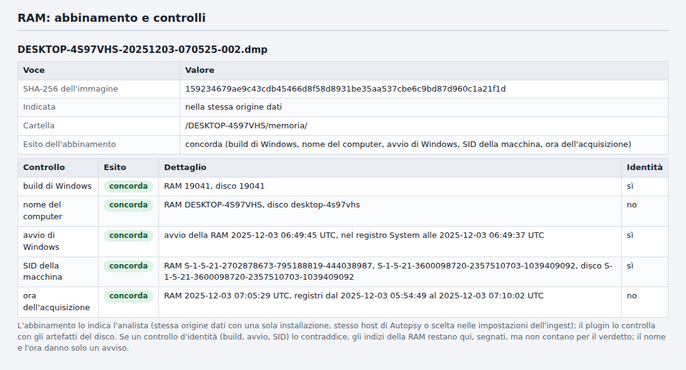

# Windows Compromise Triage per Autopsy

*Windows Compromise Triage* (triage della compromissione di Windows) è un modulo di ingest per
[Autopsy](https://www.autopsy.com/) che risponde in pochi minuti a una domanda: **quali macchine Windows vanno
esaminate per prime, e perché?**

English version of this page: [README.md](README.md)

Il modulo esegue su un'immagine del disco, oppure su un insieme di file logici, una checklist di 41 controlli (e,
quando c'è un'immagine della RAM della macchina, la applica anche ai risultati di Volatility 3) e dà un verdetto:

| Verdetto | Significato |
| --- | --- |
| **INDICATORI DI COMPROMISSIONE** | almeno un fatto decisivo: un indicatore che di rado ha una spiegazione innocente e che da solo giustifica l'esame della macchina |
| **DA VERIFICARE, PRIORITÀ ALTA** | nessun fatto decisivo, ma segnali da confermare in due famiglie che vengono da fatti diversi |
| **DA VERIFICARE** | segnali da confermare in una sola famiglia o su un solo fatto, oppure dati mancanti o illeggibili |
| **NESSUN INDICATORE TROVATO** | i controlli fatti non hanno trovato nulla. Non vuol dire che la macchina sia pulita |

> **Verdetto euristico di triage**: indica dove guardare prima. Non è una probabilità né una prova; la conclusione
> spetta all'analisi forense.

Insieme al verdetto ci sono i segnali che lo motivano, ciascuno collegato nell'albero di Autopsy al file da cui
viene, e un report HTML in un solo file.


## Indice

- [Che cosa fa](#che-cosa-fa)
- [Requisiti](#requisiti)
- [Installazione](#installazione)
- [Uso](#uso)
- [RAM (Volatility 3)](#ram-volatility-3)
- [Dove sono i risultati](#dove-sono-i-risultati)
- [Come si legge](#come-si-legge)
- [I 41 controlli](#i-41-controlli)
- [Lingua](#lingua)
- [Valutazione](#valutazione)
- [Limiti](#limiti)
- [Adattare gli elenchi](#adattare-gli-elenchi)
- [Sviluppo](#sviluppo)
- [Compatibilità e prove fatte](#compatibilità-e-prove-fatte)
- [Se qualcosa non va](#se-qualcosa-non-va)
- [Riconoscimenti](#riconoscimenti)
- [Licenza](#licenza)

## Che cosa fa

Il modulo legge da solo, con lettori propri:

- il registro: `SYSTEM`, `SOFTWARE`, `SAM`, `NTUSER.DAT`, `UsrClass.dat`, `Amcache.hve`, con i transaction log;
- i registri eventi (`.evtx`): Security, System, Application, PowerShell, Task Scheduler, Terminal Services,
  Windows Defender, WMI-Activity, Sysmon e qualche altro;
- Prefetch, attività pianificate, cartelle di esecuzione automatica, repository WMI, `CryptnetUrlCache`,
  cronologia della console di PowerShell;
- i log di AnyDesk, TeamViewer, LogMeIn e Pulseway, la cronologia dei rilevamenti di Windows Defender, il Cestino;
- se è stata acquisita la RAM della macchina: processi, connessioni e sessioni, dall'output di Volatility 3 raccolto
  con lo script della cartella `collectors/` (vedi [RAM](#ram-volatility-3)).

Lì cerca le tracce che un'intrusione di solito lascia: registri cancellati, account nuovi o nascosti, accessi da
indirizzi pubblici e raffiche di tentativi falliti, persistenza (servizi, attività pianificate, chiavi Run,
sottoscrizioni WMI), strumenti d'attacco e a doppio uso, righe di comando e processi padre sospetti, esecuzione
remota con Impacket e PsExec, strumenti di accesso remoto (RMM), rilevamenti dell'antivirus, file lasciati nelle
cartelle di appoggio, anti-forensics.

Non ha bisogno di altri moduli di ingest né di programmi esterni (per la RAM, Volatility si usa fuori da Autopsy,
prima dell'analisi), e lavora in sola lettura: non modifica mai l'origine dati. I risultati si possono avere in
italiano o in inglese.

## Requisiti

- **Autopsy 4.23.1**, la versione con cui questa release è stata provata (vedi
  [Compatibilità e prove fatte](#compatibilità-e-prove-fatte)). Il modulo usa solo quello che Autopsy ha già con sé:
  è codice Jython 2.7.
- Solo per la RAM, sul computer su cui si analizza l'immagine della RAM: **Python 3.8** o successivo e
  **[Volatility 3](https://github.com/volatilityfoundation/volatility3) 2.28.2**, la versione provata su immagini
  della RAM vere. Il raccoglitore funziona anche con versioni più vecchie di Volatility, ma lo dice: danno meno dati
  (vedi [Limiti](#limiti)). In Autopsy non va aggiunto nulla.

## Installazione

1. Scarica `TriageCompromissione-<versione>.zip` dalla pagina delle [release](../../releases) e controlla che il suo
   SHA-256 sia quello delle note della release (in PowerShell:
   `Get-FileHash .\TriageCompromissione-1.3.zip -Algorithm SHA256`).
2. In Autopsy apri **Tools > Python Plugins**: si apre la cartella dei moduli Python (su Windows di solito è
   `%APPDATA%\autopsy\python_modules`).
3. Chiudi Autopsy ed estrai lo zip in quella cartella. Deve risultare `...\python_modules\TriageCompromissione\` con
   dentro `TriageCompromissione.py` e i file `tc_*.py`.
4. Riapri Autopsy.

Nello zip della release la cartella contiene anche `collectors\collect_memory.py`, lo script per l'immagine della
RAM (vedi [RAM](#ram-volatility-3)), `tools\verify_case.py`, che controlla un caso dopo un'analisi, e `docs\`, con la
procedura per provare il modulo su una postazione Windows; Autopsy li ignora.

Per aggiornare, chiudi Autopsy, sostituisci la cartella e riapri Autopsy. Il riavvio serve anche dopo ogni modifica a
un file `tc_*.py`: da sé Autopsy ricarica soltanto il file principale.

## Uso

1. Apri o crea un caso e aggiungi l'origine dati (**Add Data Source**):
   - un'immagine del disco (E01, dd, vmdk, vhd...), oppure
   - **Logical Files**: la cartella di una raccolta di triage (KAPE, CyLR, Velociraptor...) o una copia della
     cartella Windows. Con i file logici spunta le caselle delle date (modifica, creazione, accesso): senza, il
     controllo sui file recenti non può distinguere i file recenti da quelli vecchi e li considera tutti.
2. Nell'elenco dei moduli di ingest spunta **Windows Compromise Triage** (il nome del modulo è lo stesso in
   tutte le lingue). Non ha bisogno degli altri moduli: per il solo triage puoi lasciarli tutti spenti, è il modo
   più veloce.
3. Impostazioni (il pannello a destra quando il modulo è selezionato; restano memorizzate per le volte
   successive):
   - **Giorni da considerare «recenti»** (predefinito 30). Si contano all'indietro dall'ultima attività della
     macchina, non da oggi.
   - **Accesso remoto autorizzato (RMM)**: i nomi degli strumenti di accesso remoto autorizzati su quella
     macchina, separati da virgola (per esempio `TeamViewer, AnyDesk`). Restano nel report come contesto ma non
     pesano sul verdetto; la copia rinominata di uno strumento autorizzato resta invece un segnale da confermare.
     Un nome che non corrisponde a nessuno strumento conosciuto viene segnalato nel report.
   - **Lingua dei risultati**: italiano o inglese, vedi [Lingua](#lingua).
   - **RAM (risultati di Volatility)**: quale raccolta della RAM va con la macchina. *Automatica* usa la raccolta
     nella stessa origine dati (se l'origine contiene una sola installazione di Windows) e quelle nelle origini dello
     stesso host di Autopsy; *Nessuna* non ne usa; oppure scegli una delle raccolte già nel caso. Vedi
     [RAM](#ram-volatility-3).
4. Avvia. Nelle prove ogni macchina ha richiesto da pochi secondi a un minuto; un registro Security da 1 GB
   aggiunge circa due minuti.


Se l'origine contiene più installazioni di Windows (più volumi, più macchine nella stessa cartella) ognuna ha il
suo verdetto e il suo report, fino a sei per origine dati. Le installazioni in più e le cartelle `Windows.old` non
vengono analizzate: lo dice una nota nel report.

## RAM (Volatility 3)

Un'immagine del disco non contiene ciò che era in esecuzione: processi, connessioni di rete, utenti collegati. Se è
stata acquisita la RAM della macchina (dal vivo, prima di qualunque altra cosa), il modulo può usare anche quella.
Il lavoro è diviso in due, così il verdetto viene sempre dallo stesso motore:

- `collectors/collect_memory.py` **raccoglie soltanto**. Esegue un insieme fisso di plugin di Volatility 3
  sull'immagine della RAM e ne conserva l'output JSON così com'è, accanto a un manifesto
  (`compromise-triage-memory.json`) che registra la versione di Volatility, lo SHA-256 dell'immagine e di ogni
  output, e com'è finito ogni plugin. Non giudica nulla.
- Il **modulo** applica a quella cartella le sue regole, le stesse che applica al disco, dopo che l'analista ha detto
  di quale macchina è la RAM.

**1. Raccogliere.** Sul computer di analisi, mai sulla macchina sospetta:

```
py -3 -m pip install volatility3==2.28.2
py -3 collect_memory.py D:\reperti\PC01.mem -o D:\caso\PC01_vol3
```

(su Linux e macOS scrivi `python3` al posto di `py -3`). Lo script sta nella cartella `collectors` del repository e
dello zip della release. Prima di raccogliere fa un **controllo preliminare** e ne scrive l'esito nel manifesto: le
versioni di Python e di Volatility (con un avviso se Volatility è più vecchio della 2.28.2), i plugin che questo
Volatility sa caricare (un plugin che non ha viene saltato e indicato come «non disponibile»), i simboli (una
cartella locale, oppure il server dei simboli di Microsoft raggiungibile) e lo spazio libero. `--vol` dice come avviare
Volatility quando non è installato nello stesso Python (per esempio `--vol "py -3 C:\volatility3\vol.py"`); la prima
volta Volatility scarica da Microsoft i simboli di ogni versione di Windows, quindi su un computer senza Internet usa
`--symbols` con un pacchetto di simboli e `--offline`; `--timeout` ferma un plugin che dura troppo (predefinito 120
minuti); `--no-hash` salta lo SHA-256; `--lang it|en` sceglie la lingua dei messaggi. A seconda della dimensione
dell'immagine servono da pochi minuti a mezz'ora.

| Plugin di Volatility 3 | A cosa serve |
| --- | --- |
| `windows.info` | ora di sistema dell'acquisizione, build di Windows |
| `windows.pslist`, `windows.pstree`, `windows.psscan`, `windows.cmdline` | controllo 4: processi, righe di comando, processi padre, processi nascosti |
| `windows.netscan` (`windows.netstat` se netscan non riesce) | controlli 5 e 7: le connessioni e i loro processi |
| `windows.sessions` | controllo 3: chi era collegato, alla console o con il Desktop remoto |
| `windows.envars`, `windows.getsids` | il nome del computer, l'utente di ogni processo, il SID della macchina |
| `windows.svcscan` | i servizi nella RAM che il registro non ha più (controlli 17 e 29) |

Dopo la raccolta lo script confronta l'output con quello che un Windows acceso ha sempre: decine di processi, tra cui
`System`, `smss.exe`, `csrss.exe`, `wininit.exe`, `services.exe` e `lsass.exe`; righe di comando leggibili; porte in
ascolto; centinaia di servizi e di variabili d'ambiente; e non molti più processi in `psscan` che in `pslist`. Sotto
queste soglie, come con un'immagine tagliata, scrive *output anomalo o forse incompleto* ed esce con codice 1, così
l'acquisizione si può ripetere. Dice anche quando le connessioni vengono da `netstat` al posto di `netscan`, che non
vede le connessioni già chiuse. Codici di uscita: 0 se tutto è riuscito, 1 se qualche plugin non è riuscito o
l'output sembra anomalo (la cartella si può usare lo stesso: il modulo dice che cosa manca), 2 se non si è potuto
eseguire nulla.

**2. Aggiungere la cartella al caso** come **Logical Files**, e dire di quale macchina è. Il modulo non abbina mai RAM
e disco per nome del computer: un clone, una macchina reinstallata o un nome standard unirebbero due macchine
diverse. L'abbinamento lo fa l'analista, in uno di tre modi:

- metti la cartella nella **stessa origine dati** dei file della stessa macchina (per esempio accanto alla sua
  raccolta KAPE, prima di aggiungerla). Vale quando l'origine contiene una sola installazione di Windows: con più
  installazioni la RAM non va a nessuna, con un avviso;
- aggiungi la cartella allo **stesso host di Autopsy** del disco: nella procedura Add Data Source, alla pagina *Select
  Host*, scegli *Use existing host* e l'host del disco. Le origini già aggiunte si spostano unendo i loro host
  (*Merge Into Other Host*);
- scegli la raccolta nelle impostazioni del modulo, **RAM (risultati di Volatility)**: l'elenco mostra le raccolte del
  caso, per origine dati e cartella.

Poi esegui il modulo sul disco. Se la RAM viene aggiunta dopo l'analisi del disco, esegui di nuovo il modulo sul
disco: i risultati nuovi sostituiscono i vecchi. Una RAM di un altro host non viene usata; se ha lo stesso nome di
computer della macchina, lo dice una nota. Eseguito sulla sola cartella della RAM, il modulo dà un verdetto dalla sola
RAM, con gli avvisi di copertura per tutto quello che avrebbe mostrato un disco.

**3. Il modulo controlla l'abbinamento** con quello che ha già letto sul disco: la build di Windows (per kernel:
Windows 10 dalla 2004 alla 22H2 gira sul kernel 19041), il nome del computer (con tutti i nomi che la macchina ha
avuto nel registro e nei registri eventi), l'ora di avvio (con gli eventi di avvio del registro System, quando il
registro copre quell'ora), il SID della macchina e l'ora dell'acquisizione con il periodo coperto dai registri eventi.
Se la build, l'avvio o il SID contraddicono la scelta, un avviso lo dice e gli indizi di quella RAM restano nel report,
segnati, ma non contano per il verdetto finché la scelta non viene corretta; un nome o un'ora diversi danno solo un
avviso. Il report ha una sezione *RAM: abbinamento e controlli* con l'immagine (e il suo SHA-256), chi l'ha scelta e
l'esito di ogni controllo. Il nome dell'installazione non viene mai dalla RAM.



**4. Che cosa trova il modulo nella RAM.**

- Con le stesse regole del disco: strumenti d'attacco e a doppio uso, programmi che girano da cartelle dove i
  programmi non stanno (`C:\Users\Public`, `PerfLogs`, un `svchost.exe` fuori da System32...), righe di comando
  giudicate come per gli eventi 4688 (PowerShell codificato, scarica ed esegui, tunnel con `ssh -R`, `-L` o `-D`...),
  processi padre (`lsass.exe` o `wininit.exe` che avviano un interprete di comandi, una shell avviata da netcat o
  ncat...), strumenti di accesso remoto (si aggiungono ai controlli 32-36), servizi con le firme di Impacket.
- Con regole che hanno senso solo nella RAM, con l'etichetta *regola in più*: un processo trovato dalla scansione
  della memoria ma assente dall'elenco dei processi attivi (*forse nascosto*), un processo di sistema con un padre
  insolito o in più copie, un programma per documenti o un server web che avvia un interprete di comandi, un
  programma di Windows che di norma non parla con Internet (`rundll32.exe`, `mshta.exe`, `regsvr32.exe`...) con una
  connessione verso un indirizzo pubblico, processi con l'utente di un account che i registri eventi mostrano appena
  creato o aggiunto agli amministratori. Una sessione di Desktop remoto aperta al momento dell'acquisizione è
  riportata come contesto.
- Il report riceve le tabelle delle sessioni, dei processi, delle connessioni e delle connessioni SMB trovate nella
  RAM. Nella tabella delle connessioni, «?» vuol dire che Volatility non ha attribuito la connessione a un processo
  (succede con le build di cui conosce meno le strutture di rete, per esempio Windows 11 22H2 e 23H2): non è un
  segnale.

**5. Quando i risultati sono parziali.** Se un plugin di Volatility non è riuscito, è stato fermato o manca, il report
dice quale, con il motivo scritto nel manifesto, e quali controlli sono incompleti; un file che Volatility non
riconosce (non è un'immagine della memoria di Windows, oppure mancano i simboli) viene indicato come tale. Righe e
SHA-256 di ogni output vengono confrontati con il manifesto, e una raccolta interrotta viene segnalata. Il modulo
applica le stesse soglie di plausibilità del raccoglitore: un output anomalo dà un avviso, e i suoi indizi restano nel
report ma non portano il verdetto oltre «da verificare». Nella tabella dei 41 controlli un controllo a cui manca una
fonte è *Parziale*: per esempio il 5 e il 7 quando le connessioni vengono da `netstat`, il 17 e il 29 quando manca
`svcscan` (i servizi rimasti solo in memoria, come fa smbexec, non si controllano). Un controllo parziale o non
verificabile perché una fonte non è riuscita esclude «nessun indicatore trovato».

La cache DNS (controllo 6) e le sessioni SMB con utente e condivisioni non si ricavano con i plugin standard di
Volatility 3: restano al triage dal vivo. La sorgente dati sperimentale per la memoria di Autopsy (solo su Windows,
basata su Volatility 2.6) è un'altra cosa e non serve.

## Dove sono i risultati

- **Posta di ingest** (la busta in alto a destra): verdetto, numero di fatti e di segnali, percorso del report.
- **Albero di Autopsy, Analysis Results**:
  - *Triage compromissione: verdetto*: una voce per macchina;
  - *Triage compromissione: segnali*: una voce per segnale, collegata al file da cui viene (hive, registro
    eventi, file `.pf`, file JSON di Volatility...), con il numero del suo fatto e la sua origine (disco, oppure RAM
    con lo SHA-256 dell'immagine). I segnali che vengono da una RAM tenuta in un'altra origine dati sono collegati
    all'origine analizzata.

  Il verdetto *Indicatori di compromissione* ha punteggio *Notable*, *Da verificare* con segnali *Likely Notable*. I
  segnali decisivi hanno punteggio *Notable* e quelli da confermare *Likely Notable*, salvo quelli di una RAM che il
  disco contraddice (*Unknown*) o di una RAM anomala (al massimo *Likely Notable*). Compaiono anche sotto il nodo
  *Score* dell'albero.

  
- **Report**: `<cartella del caso>\Reports\TriageCompromissione\`
  - `Triage_<computer>_<data>.html`: il report completo;
  - `Triage_<computer>_<data>.csv`: i soli segnali, con il fatto, l'origine, se contano e il loro stato.

  Il report è elencato anche nell'albero, sotto **Reports**.

Nel report gli orari sono UTC. L'unica eccezione, indicata dove compare, è il log delle connessioni di
TeamViewer, che è scritto nell'ora locale della macchina. Nell'albero di Autopsy gli orari seguono invece il fuso
orario scelto in **Tools > Options > View**.

Se rilanci il modulo sulla stessa origine i risultati vecchi vengono sostituiti dai nuovi, tranne quelli a cui hai
messo un tag: quelli restano. I report delle esecuzioni precedenti non vengono cancellati.

## Come si legge

Ogni segnale ha un **peso**:

| Peso | Significato | Esempi |
| --- | --- | --- |
| **Decisivo** | di rado ha una spiegazione innocente e da solo giustifica l'esame della macchina. Non è una prova | Mimikatz eseguito, un servizio con le firme di smbexec, il registro Security svuotato, una shell avviata da `lsass.exe` o da netcat |
| **Da confermare** | lo fa chi attacca, ma anche un amministratore | PsExec, un account creato da riga di comando, RDP da un indirizzo pubblico, uno strumento di assistenza remota, uno strumento a doppio uso trovato solo per nome |
| **Informativo** | solo contesto: non pesa sul verdetto (nel report questi segnali sono raggruppati sotto *Solo contesto*) | |

e una **famiglia**: Accessi, Account, Persistenza, Programmi eseguiti, Strumenti d'attacco, Strumenti a doppio
uso, Esecuzione remota, Accesso remoto (RMM), File, Anti-forensics, Antivirus, Esfiltrazione e tunnel.

I segnali sullo stesso oggetto (un processo, un comando, un file, un'attività, un servizio, un account, un indirizzo,
un registro, un blocco di script) formano un **fatto**: lo stesso comando visto nell'evento 4688, in Sysmon e nella
RAM è un fatto solo, e lo sono anche il comando che crea un account e l'evento 4720 di quell'account. Il report conta
i fatti («2 fatti decisivi (3 segnali)») e la sua tabella *Fatti* dice dove è stato visto ciascuno: più fonti
confermano che una cosa è avvenuta, non che sia più grave. La riga sotto conta i segnali per origine e peso («disco:
decisivi 25, da confermare 31»): lì si conta anche un segnale da confermare che appartiene a un fatto decisivo, perciò
può dare più segnali da confermare della riga dei fatti, che li conta solo per i fatti da confermare.

Il verdetto:

| Situazione | Verdetto |
| --- | --- |
| almeno **un fatto decisivo** | Indicatori di compromissione |
| segnali da confermare in **due o più famiglie**, da **fatti diversi** | Da verificare, priorità alta |
| segnali da confermare in una sola famiglia, o tutti sullo stesso fatto | Da verificare |
| segnali solo da una RAM anomala o da fonti che non concordano | Da verificare |
| nessun segnale decisivo o da confermare, ma almeno un avviso di copertura | Da verificare |
| altrimenti | Nessun indicatore trovato |

Gli **avvisi di copertura** dicono che cosa il triage non ha potuto vedere: registri eventi o hive assenti,
danneggiati o troppo corti, file illeggibili, registri che si fermano prima degli altri artefatti, risultati della RAM
mancanti, parziali o non plausibili, una RAM che il disco contraddice, controlli interrotti da un errore. Un «nessun
indicatore trovato» vale solo se non ci sono avvisi: per questo un avviso da solo porta a «Da verificare». Le **note**
sono osservazioni che non toccano il verdetto (orologio spostato, date dei file che sono quelle della copia, un
Volatility più vecchio...).

Lo stesso comando pesa in modo diverso secondo dove lo si trova. In una voce che parte da sola (servizio, attività
pianificata, chiave Run, sottoscrizione WMI) o incollato nella finestra Esegui, un comando codificato o che scarica
ed esegue codice è decisivo. Tra i comandi soltanto eseguiti (eventi 4688, Sysmon, PowerShell, cronologia della
console) è da confermare, perché gli strumenti di gestione fanno cose simili ogni giorno; resta decisivo solo ciò
che non ha spiegazioni innocenti (uno strumento d'attacco, l'output su `\\127.0.0.1` di Impacket, una reverse
shell...). Durante l'installazione di Windows (dalla data di installazione nel registro, oppure dai registri eventi,
che mostrano i nomi che la macchina ha avuto mentre veniva preparata) gli account e i servizi creati dal setup e gli
script che preparano l'immagine sono solo contesto.

«Recente» non vuol dire vicino a oggi. La finestra si conta all'indietro da un momento di riferimento: il più
vecchio tra l'ultimo evento scritto nel registro Security e l'ultimo scritto nel System (se mancano, gli altri
registri e l'ora dell'ultimo spegnimento). Il report dice qual è.

**Ogni segnale vale solo finché l'IT non lo spiega.** Il triage serve a decidere dove guardare prima: non
sostituisce l'analisi.

## I 41 controlli

| N. | Fase | Controllo |
| --- | --- | --- |
| 1 | 1. Contesto e dati volatili | Contesto del sistema |
| 2-7 | | Copia del Prefetch, utenti collegati, processi, connessioni di rete, cache DNS, sessioni SMB: passi del triage dal vivo, *su un'immagine del disco non si applicano*; 3, 4, 5 e 7 si fanno anche su un'immagine della RAM (vedi [RAM](#ram-volatility-3)) |
| 8 | 2. Account e accessi | Copertura dei log e audit attivi |
| 9 | | Log cancellati |
| 10 | | Account locali, amministratori, profili |
| 11 | | Logon remoti di rete e RDP |
| 12 | | Accessi falliti per indirizzo |
| 13 | | Credenziali esplicite e connessioni in uscita |
| 14 | | Sessioni RDP (Terminal Services) |
| 15 | 3. Persistenza | Attività pianificate |
| 16 | | Attività nascoste |
| 17 | | Servizi |
| 18 | | Servizi installati (evento 7045) |
| 19 | | Chiavi Run e cartelle Esecuzione automatica |
| 20 | | Sottoscrizioni WMI |
| 21 | 4. Programmi eseguiti | Prefetch |
| 22 | | BAM |
| 23 | | RunMRU |
| 24 | | Download con certutil |
| 25 | | Comandi sospetti (eventi 4688, Sysmon, PowerShell) |
| 26 | | ShimCache, AmCache, UserAssist |
| 27 | 5. Esecuzione remota con Impacket | Attività create e cancellate in pochi istanti |
| 28 | | Firme di atexec nelle attività |
| 29 | | Firme di smbexec nei servizi |
| 30 | | File residui |
| 31 | | Accessi alle share (evento 5145) |
| 32 | 6. Strumenti di accesso remoto (RMM) | Programmi installati |
| 33 | | RMM portabili, anche rinominati |
| 34 | | AnyDesk |
| 35 | | TeamViewer |
| 36 | | LogMeIn e Pulseway |
| 37 | 7. File, antivirus e anti-forensics | Rilevamenti dell'antivirus |
| 38 | | File recenti nelle cartelle di appoggio |
| 39 | | Cestino |
| 40 | | Copie shadow |
| 41 | | Artefatti disattivati |

I controlli da 2 a 7 appartengono al triage dal vivo. Il controllo 2, la copia della cartella Prefetch, su
un'immagine non serve, perché il Prefetch viene letto direttamente dal controllo 21. I controlli da 3 a 7 riguardano
dati volatili, che su un'immagine del disco non esistono: il report li indica come «Non verificabile», a meno che non
sia stata indicata una raccolta della RAM della macchina (vedi [RAM](#ram-volatility-3)); in quel caso i controlli 3,
4, 5 e 7 vengono fatti sulla RAM. Tutti gli altri controlli vengono eseguiti; il report ha una tabella con l'esito di
ciascuno: un segnale con il suo peso, *Nulla da segnalare*, *Parziale* (fatto, ma una fonte manca o è incompleta: la
nota dice quale), *Artefatto non trovato*, *Non verificabile*, *Non eseguito*.

I segnali con l'etichetta **regola in più** vengono da regole note che non fanno parte delle guide su cui è
costruita la checklist (sticky keys, esclusioni di Defender, cronologia di PowerShell, inoltro di porta, account
nascosti...).

## Lingua

Il modulo parla italiano e inglese.

- **Risultati** (messaggio nella posta, albero, report HTML, CSV): la lingua scelta nel pannello delle
  impostazioni, *Lingua dei risultati*. La prima volta è già impostata sulla lingua del sistema; poi resta
  memorizzata come le altre impostazioni.
- **Pannello delle impostazioni e descrizione del modulo**: la lingua del sistema, cioè quella di Java: italiano su
  un sistema in italiano, inglese in tutti gli altri casi.
- **Nome del modulo**: sempre *Windows Compromise Triage*. Autopsy riconosce i moduli di ingest dal nome, nelle
  impostazioni salvate e nei profili di ingest: per questo il nome non cambia con la lingua.

Due cose da sapere:

- In un caso, i nomi dei due tipi di risultato nell'albero e delle loro colonne vengono creati dalla prima analisi
  e restano in quella lingua anche se un'analisi successiva usa l'altra; il contenuto dei risultati segue invece
  la lingua di ogni analisi.
- Il file CSV usa come separatore il punto e virgola in italiano e la virgola in inglese: è quello che Excel si
  aspetta con le rispettive impostazioni internazionali.

## Valutazione

Il modulo è stato misurato su dati con etichette scritte da altri: registri eventi di attacchi, installazioni pulite
di Windows e la RAM di due macchine compromesse vere. La valutazione completa della versione 1.2, con il metodo, è
allegata alla release, con il registro delle prove della versione 1.3; la versione 1.3 ne applica le correzioni.
Questi sono i numeri che contano per l'uso del modulo. Le percentuali sono sui campioni che contengono almeno un
evento letto dalle regole («nell'ambito»); gli intervalli sono di Wilson al 95%.

| Che cosa | Dati | Versione 1.2 | Versione 1.3 |
| --- | --- | --- | --- |
| Campioni d'attacco con almeno un segnale da confermare o decisivo | 161 registri eventi di attacchi nell'ambito ([EVTX-to-MITRE-Attack](https://github.com/mdecrevoisier/EVTX-to-MITRE-Attack)) | 88 (55%) | 90 (56%, 48-63%) |
| ... con un segnale per la tecnica dell'etichetta | gli stessi | 70 (43%) | 72 (45%, 37-52%) |
| ... con il verdetto più forte, per la tecnica | gli stessi | 26 (16%) | 26 (16%, 11-23%) |
| ... senza nessun segnale | gli stessi | 73 (45%) | 71 (44%, 37-52%) |
| Record di questi registri che il modulo non ha decodificato | 12.812 record | 1.681 (13%) | 0 |
| Installazioni pulite con il verdetto più forte | 7 installazioni ([evtx-baseline](https://github.com/NextronSystems/evtx-baseline)) | 3 | 2 |
| Installazioni pulite con segnali da confermare o decisivi | le stesse | 4 | 4 |
| Insieme sigillato, usato una volta | 37 campioni d'attacco mai usati prima | — | 25 su 33 nell'ambito con segnali (76%, 59-87%), 16 per la tecnica (48%, 33-65%); verdetto più forte per la tecnica 11 (33%, 20-50%); nessun segnale 8 (24%, 13-41%) |

Come leggerli:

- **Un verdetto negativo non esclude un attacco.** Su questi campioni d'attacco, il 44% di quelli nell'ambito non dà
  nessun segnale (il 24% nell'insieme sigillato). «Nessun indicatore trovato» e «Da verificare» vogliono dire che il
  triage non ha visto nulla, non che non ci sia nulla.
- **Il verdetto più forte è raro su un solo registro di pochi minuti.** Il verdetto è fatto per sommare prove di tipi
  diversi (registro di sistema, file, eventi); un campione d'attacco ne offre poche.
- **I falsi allarmi sulle installazioni pulite** venivano da registri cancellati da chi ha preparato i dati, da
  account, servizi e script dell'installazione, e da programmi di accesso remoto installati apposta: la versione 1.3
  tratta l'installazione come contesto e non lascia più che due programmi di accesso remoto da soli diano il verdetto
  più forte. Il verdetto più forte resta su due installazioni, entrambe per i registri cancellati da chi ha preparato
  i dati; senza quei registri non resterebbe su nessuna, e una delle due (RDP da un indirizzo pubblico e due programmi
  di accesso remoto) sarebbe «da verificare, priorità alta».
- **Dopo le correzioni, quegli insiemi non sono più indipendenti.** I numeri della 1.3 sui campioni d'attacco e sulle
  installazioni pulite sono misurati sui dati che hanno guidato le correzioni: dicono che le correzioni funzionano lì,
  non come va il modulo su dati nuovi. L'insieme sigillato è la sola misura su dati che non hanno guidato nessuna
  modifica: 37 registri eventi di attacchi di
  [hayabusa-sample-evtx](https://github.com/Yamato-Security/hayabusa-sample-evtx) che non hanno né eventi né nomi di
  file in comune con i dati già usati, eseguiti una volta sola con il codice definitivo e con il protocollo scritto
  prima. È piccolo e viene da una sola raccolta. Anche lì basta un registro cancellato all'inizio della registrazione,
  che l'etichetta non nomina, per il verdetto più forte: dei 20 campioni che lo ricevono, 9 lo devono solo a quello, e
  i numeri «per la tecnica» li lasciano fuori.
- **Non misurato**: macchine intere, compromesse e pulite, da fonti indipendenti, incidenti veri, configurazioni
  aziendali. Il verdetto su una macchina intera non ha un tasso d'errore misurato.
- **RAM**: sulle due macchine compromesse vere della valutazione, con Volatility 2.28.2, la versione 1.3 segnala 3
  degli 11 processi dell'attacco della macchina Windows 11 dalla sola RAM (la shell avviata da ncat, decisiva; ncat e
  un tunnel SSH, da confermare) e, con i registri eventi della macchina Windows 10, 3 dei suoi 5 (i processi
  dell'account creato dall'attaccante); la versione 1.2 ne segnalava 1 su 16. Nessuno dei 360 processi benigni è
  segnalato. Con Volatility 2.4.1 un processo benigno che `windows.pslist` non elenca risulta *forse nascosto*, segnato
  come discordanza fra fonti, e non conta. La RAM della macchina Windows 10 da sola non dà nessun segnale, quindi «da
  verificare». Un'immagine della RAM tagliata a metà ora dà l'avviso *output anomalo o forse incompleto*: i 30 processi
  che risultano *forse nascosti* restano nel report, segnati come incerti, e non portano oltre «da verificare» (la
  versione 1.2 non dava nessun avviso). Due macchine descrivono i casi provati, non sono un tasso; una macchina pulita
  intera con la sua RAM vera non è mai stata provata, quindi «nessun indicatore trovato» con la RAM non ha una misura.

## Limiti

- **Che cosa le regole vedono poco** (le tecniche in cui sono sfuggiti più campioni d'attacco nella valutazione):
  servizi creati o modificati (T1543.003), manipolazione di account (T1098), file e comandi offuscati (T1027),
  movimento laterale con RDP, DCOM e SSH (T1021), forza bruta (T1110), ricognizione di account e gruppi (T1087,
  T1069). La versione 1.3 non aggiunge regole su questi temi: le regole nuove vanno misurate su dati non usati per
  scriverle.
- Uno strumento trovato sul disco solo per nome è al massimo «da confermare»: un nome non prova né che il file sia
  quello strumento né che sia stato eseguito, salvo una prova d'esecuzione o le informazioni di versione del file.
- ShimCache e AmCache provano che un file esisteva, non che sia stato eseguito: il report lo dice voce per voce. Su
  Windows 8 e successivi, la mancanza di `Amcache.hve` dà un avviso di copertura.
- Le sottoscrizioni WMI vengono cercate anche tra gli oggetti cancellati del repository: una voce trovata può non
  essere più attiva.
- Le copie shadow non vengono aperte: il report dice solo se esistono.
- I transaction log del registro nel formato vecchio (prima di Windows 8.1) non vengono applicati.
- Un indirizzo IPv6 non viene mai considerato «pubblico».
- I comandi offuscati con `^` o `""` dentro le parole vengono ricomposti e quelli di PowerShell codificati vengono
  decodificati; offuscamenti più elaborati non vengono sciolti.
- Le righe di comando si vedono solo se la macchina le registrava (evento 4688 con la riga di comando, Sysmon, i
  registri di PowerShell): Windows non lo fa di serie. Senza, restano i controlli su registro, file, servizi,
  attività, Prefetch e accessi.
- Con una raccolta parziale di file il verdetto più frequente è «Da verificare», con gli avvisi che dicono che cosa
  manca.
- I file cancellati vengono usati solo dove contano (residui di Impacket, strumenti noti cercati per nome).
- Ogni controllo tiene al massimo 40 segnali dello stesso peso e della stessa famiglia (160 per quelli decisivi).
  Quando sono di più, il report dice quanti erano in tutto.
- Un fatto è un oggetto (un processo, un comando, un file, un'attività, un servizio, un account, un blocco di
  script...), non un'azione: un passo dell'attacco registrato in più oggetti conta come più fatti. Sui registri
  eventi di una delle macchine vere della valutazione il report conta 12 fatti decisivi, cinque dei quali sono
  blocchi di script PowerShell di stager che il modulo non lega al comando che li ha lanciati.
- Gli strumenti vengono cercati per nome. Un eseguibile rinominato viene riconosciuto solo dalle informazioni di
  versione, che vengono lette per i 400 eseguibili più recenti nelle cartelle di appoggio (Download, Desktop,
  Public, Temp, ProgramData...).
- La RAM è una fotografia di un istante. Un processo già finito si vede solo finché la sua struttura non è stata
  sovrascritta (psscan), e la riga di comando e l'utente mancano per i processi la cui memoria era nel file di
  paging. Un processo *forse nascosto* va confermato: la scansione della memoria a volte trova i resti di un
  processo appena terminato.
- Nella RAM il nome di un processo è troncato a 14 caratteri quando Volatility non riesce a leggere il percorso
  completo del programma.
- L'iniezione di codice non viene cercata: il raccoglitore non esegue `windows.malfind`.
- Con un Volatility più vecchio della 2.28.2 il modulo riceve meno dati: nella 2.4.x `windows.svcscan` non si carica
  senza `yara-python` (i controlli 17 e 29 restano incompleti, e il report lo dice); su Windows 11 build 22621
  `windows.netscan` della 2.4.1 non trova nessuna connessione TCP, solo le porte in ascolto; su un'immagine
  `windows.pslist` della 2.4.1 ha perso un processo attivo. Con la 2.28.2, su Windows 11 build 22621 le connessioni TCP
  stabilite arrivano senza processo e senza ora di creazione («?»).

## Adattare gli elenchi

I nomi e gli schemi con cui lavorano le regole sono in `TriageCompromissione/tc_regole.py`, in elenchi commentati
(i controlli che li usano sono nei file `tc_c_*.py`):

| Elenco | Contenuto |
| --- | --- |
| `RMM` | strumenti di accesso remoto e come si riconoscono |
| `_RX_ATTACCO`, `_NOMI_ATTACCO_ESATTI` | nomi di strumenti d'attacco (decisivi) |
| `_RX_DOPPIO_USO`, `_NOMI_DOPPIO_ESATTI` | strumenti a doppio uso (da confermare) |
| `FRAMMENTI_STRUMENTI` | frammenti di nome usati per cercare sul disco gli strumenti qui sopra: uno strumento aggiunto agli elenchi sopra viene cercato sul disco solo se qui c'è anche un frammento del suo nome |
| `_RX_PS_ATTACCO` | script e comandi PowerShell d'attacco |
| `COMANDI` | comandi che pesano da soli, con il loro peso |
| `PADRI_MAI_INTERPRETI`, `STRUMENTI_DI_RETE` | processi di sistema che non avviano mai interpreti, strumenti di rete la cui shell figlia è decisiva |
| `_NOMI_ANTIVIRUS` | servizi e processi degli antivirus |
| `_HOST_PRODUTTORI` | siti da cui è normale scaricare un installer |
| `_NOTI` | script di installazione conosciuti (Chocolatey, Scoop...) |
| `_PAROLE_NEI_NOMI` | parole che distinguono un nome vero da otto lettere a caso |

Dopo una modifica riavvia Autopsy ed esegui le prove (vedi sotto). Una regola nuova o corretta va accompagnata dalla
sua fonte e dai suoi casi di prova, compresi quelli puliti che non devono farla scattare, e misurata su dati non usati
per scriverla.

## Sviluppo

```
TriageCompromissione/     il plugin: è la cartella da copiare in Autopsy
  TriageCompromissione.py   il modulo di ingest (il solo file che parla con Autopsy)
  tc_controlli.py           il motore: esegue i controlli, riunisce i segnali in fatti e decide il verdetto
  tc_c_registro.py, tc_c_eventi.py, tc_c_file.py   i controlli
  tc_regole.py              le regole (elenchi e valutazione delle righe di comando)
  tc_registro.py, tc_evtx.py, tc_prefetch.py, tc_artefatti.py   i lettori
  tc_eventi.py, tc_origine.py, tc_base.py           raccolta degli eventi, accesso all'origine, funzioni comuni
  tc_memoria.py             la RAM: legge l'output di Volatility 3, controlla l'abbinamento e lo giudica
  tc_report.py              report HTML e CSV
  tc_lingua.py, tc_lingua_en.py   scelta della lingua e catalogo inglese
collectors/collect_memory.py   esegue Volatility 3 su un'immagine della RAM (Python 3, fuori da Autopsy)
tests/                    prove del motore delle regole (Jython) e del raccoglitore della RAM (Python 3)
tools/check_translations.py   controlla il catalogo inglese rispetto al codice
tools/verify_case.py      controlla un caso di Autopsy dopo un'analisi (Python 3)
tools/make_release.py     prepara lo zip da allegare a una release (riproducibile)
docs/windows-test.md      come provare il modulo su una postazione Windows (in inglese)
docs/screenshots/         le immagini di questa pagina
```

Il codice, i commenti e i nomi interni sono in italiano, la lingua in cui il plugin è nato. Ogni testo mostrato
all'analista è scritto in italiano nel codice, dentro `tr(u'...')`, e ha la sua traduzione inglese in
`tc_lingua_en.py`; `N_(u'...')` segna soltanto un testo definito una volta sola al caricamento, che viene poi
tradotto con `tr()` dove si mostra.

I file sorgente devono restare in ASCII puro: le lettere accentate si scrivono come sequenze `\uXXXX` (per esempio
`\u00e8` per «è»), la forma più sicura con Jython 2.7.

**Controllare le traduzioni** (Python 3.8 o successivo):

```
python3 tools/check_translations.py
```

(su Windows: `py -3 tools\check_translations.py`)

Segnala i testi senza traduzione inglese, le traduzioni non più usate e quelle i cui segnaposto (`%s`, `%d`...) o
tag HTML non corrispondono al testo italiano.

**Eseguire le prove** richiede solo Java e il jar di Jython. Il jar si trova in ogni installazione di Autopsy; su
Windows Autopsy ha anche il suo Java:

```
"C:\Program Files\Autopsy-4.23.1\jre\bin\java.exe" -jar "C:\Program Files\Autopsy-4.23.1\autopsy\modules\ext\jython-standalone-2.7.4.jar" tests\run_tests.py
```

(adatta i due percorsi alla tua installazione; in PowerShell metti `&` davanti al comando; su Linux e macOS usa
`java -jar .../jython-standalone-2.7.4.jar tests/run_tests.py`). Le prove passano al motore delle regole alcune
centinaia di righe di comando, definizioni di servizi, sequenze di eventi, output della RAM e orari costruiti apposta,
e confrontano l'esito con quello atteso, nelle due lingue. Non servono né Autopsy né reperti.

**Provare il raccoglitore della RAM** richiede Python 3.8 o successivo, e né Volatility né un'immagine della RAM: un
piccolo Volatility finto risponde come quello vero, compresi i suoi errori:

```
python3 tests/test_collect_memory.py
```

**Preparare lo zip della release**: `python3 tools/make_release.py` scrive `dist/TriageCompromissione-<versione>.zip`.
Lo zip è riproducibile (la data di ogni voce è quella dell'ultimo commit, oppure `SOURCE_DATE_EPOCH`): i controlli di
GitHub Actions lo rifanno dal tag di una release e lo confrontano con quello allegato.

Vedi [CONTRIBUTING.md](CONTRIBUTING.md) per le poche regole da seguire quando si modifica il codice. Per segnalare
un problema di sicurezza segui [SECURITY.md](SECURITY.md): in privato, non in una issue pubblica.

## Compatibilità e prove fatte

- **Autopsy 4.23.1 su Linux**: il plugin installato da uno zip fatto da `tools/make_release.py` con il codice di
  questa release, eseguito da riga di comando su un'immagine raw del disco, su file logici con due installazioni, su
  file logici con raccolte della RAM (vere e costruite), con la RAM nella stessa origine dati, nello stesso host e
  scelta nelle impostazioni; report in italiano e in inglese. Ogni esecuzione ha superato i controlli di
  `tools/verify_case.py`. Per la versione 1.3: 45 prove pianificate (53 origini dati, 54
  verdetti), con l'esito atteso scritto prima di eseguirle; 43 lo hanno rispettato esattamente, e nelle altre due
  l'avviso su `netstat` dice ciò che deve, ma nomina i plugin per esteso (`windows.netstat.NetStat`) dove l'attesa
  aveva il nome breve. Altre esecuzioni hanno fatto le immagini di questa pagina e provato lo zip stesso della
  release, con gli stessi risultati delle prove sugli stessi dati. Il registro delle prove, con il requisito,
  l'attesa e l'esito di ciascuna, è allegato alla release.
- **Windows non è stato provato.** Il programma è lo stesso, ma cambiano l'installazione, il Java incluso, la cartella
  dell'utente, l'antivirus e i percorsi. Prima di affidarti al modulo su una postazione Windows segui
  [docs/windows-test.md](docs/windows-test.md) (in inglese): richiede circa mezz'ora e finisce con
  `tools/verify_case.py`.
- **Altre versioni di Autopsy** non sono supportate da questa release. La versione 1.2 del modulo è stata provata dal
  principio alla fine in Autopsy 4.19.0, 4.20.0, 4.21.0, 4.22.1 e 4.23.1 su Linux, con risultati identici; la 1.3 solo
  nella 4.23.1.
- **Raccoglitore della RAM**: Python 3.8 e 3.11 con Volatility 3 2.28.2 su un'immagine vera di 8 GB (output
  identici), e Volatility 2.4.1 per gli avvisi del controllo preliminare; le sue prove girano con Python 3.8 e con
  l'ultimo Python.
- Il motore gira con Jython 2.7.4, quello di Autopsy 4.23.1.

Le prove sugli artefatti reali usano immagini forensi e raccolte pubbliche che non fanno parte di questo repository:
nel repository ci sono le prove che non hanno bisogno di reperti.

## Se qualcosa non va

- **Il modulo non compare nell'elenco**: la cartella non è nel posto giusto (deve essere
  `python_modules\TriageCompromissione\`) oppure Autopsy non è stato riavviato.
- **«Previously loaded ... module could not be found»**: Autopsy ricorda i moduli usati l'ultima volta. Dopo
  l'aggiornamento dalla versione 1.0, in cui il modulo si chiamava *Triage compromissione Windows*, o dopo aver tolto
  il modulo, premi OK: Autopsy mostra l'avviso una volta per ogni posto in cui aveva salvato il nome (la procedura Add
  Data Source, la finestra Run Ingest Modules, ogni profilo di ingest). Da riga di comando (`--runIngest`) la prima
  esecuzione termina con «Error running ingest on data source» e scrive lo stesso avviso nel log; intanto corregge le
  impostazioni salvate, e quella successiva funziona.
- **Autopsy si arresta quando due istanze partono insieme**: visto su Linux, con e senza questo modulo: entrambe
  copiano le loro librerie native nella stessa cartella temporanea dell'utente. Avvia un'istanza alla volta, oppure
  dai a ogni installazione la sua cartella temporanea (aggiungi `-J-Djava.io.tmpdir=<cartella>` a `default_options` in
  `etc/autopsy.conf`).
- **«Triage non riuscito su ...»**: il messaggio nella posta di ingest mostra l'errore. I dettagli sono nel log di
  Autopsy (**Help > Open Log Folder**, file `autopsy.log.0`, cerca «Triage»).
- **«Triage: nessun artefatto di Windows in ...»**: l'origine non contiene una cartella `Windows\System32\config` né
  file `.evtx` o hive riconoscibili.
- **I controlli 3-7 dicono ancora «Non verificabile» anche se la RAM è nel caso**: la RAM non è stata indicata per
  questa macchina. Mettila nella stessa origine dati o nello stesso host, oppure sceglila nelle impostazioni del modulo
  (vedi [RAM](#ram-volatility-3)), ed esegui di nuovo il modulo sul disco. Una nota nel report dice quando una RAM di un
  altro host ha lo stesso nome di computer.
- **«La RAM ... non sembra di questa installazione di Windows»**: la build, l'avvio o il SID della macchina della RAM
  contraddicono il disco. Controlla di aver scelto la raccolta giusta; la sezione *RAM: abbinamento e controlli* del
  report mostra ogni controllo.
- **«Output anomalo o forse incompleto»**: l'output di Volatility ha meno di quello che un Windows acceso ha sempre.
  Un'immagine incompleta, un'estrazione non riuscita e un occultamento non si distinguono: controlla l'immagine e, se
  puoi, ripeti l'acquisizione.
- **collect_memory.py si ferma al primo plugin con «Unsatisfied requirement»**: Volatility non ha trovato né un
  kernel di Windows né i suoi simboli. Controlla che il file sia un'immagine della RAM di Windows; senza Internet,
  dai a Volatility il pacchetto dei simboli con `--symbols`.
- **collect_memory.py dice che un plugin è «non disponibile in questo Volatility»**: il Volatility in uso non ce l'ha,
  o non riesce a caricarlo (per esempio `windows.svcscan` nella 2.4.x senza `yara-python`). Aggiorna Volatility:
  `pip install -U volatility3`.
- **Il report dice che alcuni controlli sono stati interrotti da un errore**: gli altri controlli sono stati
  eseguiti lo stesso; se non ci sono segnali il verdetto è «Da verificare» invece di «Nessun indicatore trovato».
  Apri una issue con il testo dell'errore.

## Riconoscimenti

La checklist su cui si basano i 41 controlli è costruita sulle 32 guide raccolte da Cyber Triage nel post
[Windows Artifact Forensics Guides – The Master List](https://www.linkedin.com/posts/cyber-triage_windows-artifact-forensics-guides-the-master-activity-7503822145521635328-H3iC)
(10 settembre 2026), più la guida di Cyber Triage
[How to Find WMI Consumers](https://www.cybertriage.com/blog/how-to-find-wmi-consumers/) per il controllo 20.

L'analisi della RAM si appoggia a [Volatility 3](https://github.com/volatilityfoundation/volatility3) della
Volatility Foundation, che si installa a parte ed è distribuito con la sua licenza: questo progetto non lo include.

Questo progetto è indipendente: non è affiliato né approvato da Cyber Triage, Sleuth Kit Labs, Volatility Foundation
o dal progetto Autopsy.

## Licenza

Copyright 2026 Davide Numelli

Distribuito con la [Apache License, Version 2.0](LICENSE). Il software è fornito «così com'è», senza garanzie di
alcun tipo: è un aiuto al triage, e il suo verdetto non sostituisce il giudizio di un analista.

**Autore**: Davide Numelli — GitHub [@numdav](https://github.com/numdav)
