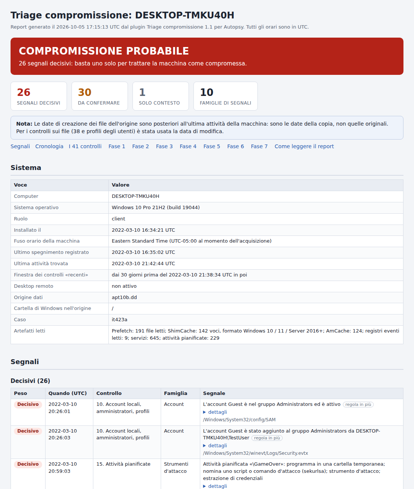
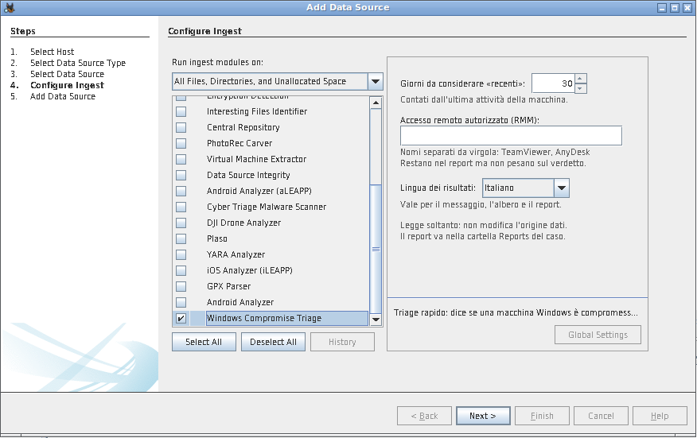
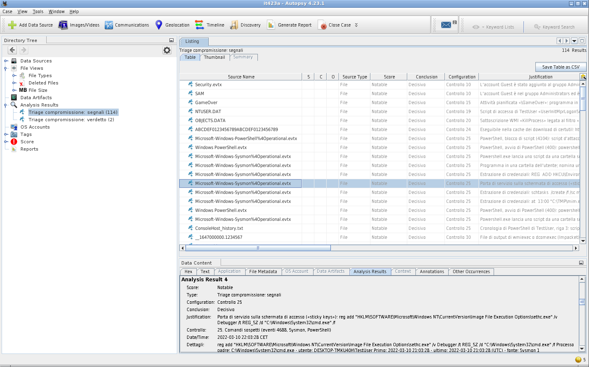

# Windows Compromise Triage per Autopsy

*Windows Compromise Triage* (triage della compromissione di Windows) è un modulo di ingest per
[Autopsy](https://www.autopsy.com/) che risponde in pochi minuti a una domanda: **questa macchina Windows è
compromessa, e merita un'analisi forense completa?**

English version of this page: [README.md](README.md)

Il modulo esegue su un'immagine del disco, oppure su un insieme di file logici, una checklist di 41 controlli e dà
un verdetto:

| Verdetto | Significato |
| --- | --- |
| **COMPROMISSIONE PROBABILE** | la macchina merita l'analisi forense completa |
| **DA VERIFICARE** | c'è qualcosa da chiarire, oppure mancano dati |
| **NESSUN INDIZIO** | i controlli fatti non hanno trovato nulla |

Insieme al verdetto ci sono i segnali che lo motivano, ciascuno collegato nell'albero di Autopsy al file da cui
viene, e un report HTML in un solo file.



## Indice

- [Che cosa fa](#che-cosa-fa)
- [Requisiti](#requisiti)
- [Installazione](#installazione)
- [Uso](#uso)
- [Dove sono i risultati](#dove-sono-i-risultati)
- [Come si legge](#come-si-legge)
- [I 41 controlli](#i-41-controlli)
- [Lingua](#lingua)
- [Limiti](#limiti)
- [Adattare gli elenchi](#adattare-gli-elenchi)
- [Sviluppo](#sviluppo)
- [Compatibilità e prove fatte](#compatibilità-e-prove-fatte)
- [Se qualcosa non va](#se-qualcosa-non-va)
- [Riconoscimenti](#riconoscimenti)
- [Licenza](#licenza)

## Che cosa fa

Il modulo legge da solo, con lettori propri:

- il registro: `SYSTEM`, `SOFTWARE`, `SAM`, `NTUSER.DAT`, `UsrClass.dat`, `Amcache.hve`, con i transaction log;
- i registri eventi (`.evtx`): Security, System, Application, PowerShell, Task Scheduler, Terminal Services,
  Windows Defender, WMI-Activity, Sysmon e qualche altro;
- Prefetch, attività pianificate, cartelle di esecuzione automatica, repository WMI, `CryptnetUrlCache`,
  cronologia della console di PowerShell;
- i log di AnyDesk, TeamViewer, LogMeIn e Pulseway, la cronologia dei rilevamenti di Windows Defender, il Cestino.

Lì cerca le tracce che un'intrusione di solito lascia: registri cancellati, account nuovi o nascosti, accessi da
indirizzi pubblici e raffiche di tentativi falliti, persistenza (servizi, attività pianificate, chiavi Run,
sottoscrizioni WMI), strumenti d'attacco e a doppio uso, righe di comando sospette, esecuzione remota con Impacket
e PsExec, strumenti di accesso remoto (RMM), rilevamenti dell'antivirus, file lasciati nelle cartelle di appoggio,
anti-forensics.

Non ha bisogno di altri moduli di ingest né di programmi esterni, e lavora in sola lettura: non modifica mai
l'origine dati. I risultati si possono avere in italiano o in inglese.

## Requisiti

- Autopsy 4.19 o successivo (il modulo usa i risultati di analisi e i punteggi introdotti con la 4.19).
- Nient'altro: è codice Jython 2.7 e usa solo quello che Autopsy ha già con sé.

## Installazione

1. Scarica `TriageCompromissione-<versione>.zip` dalla pagina delle [release](../../releases) ed estrailo (oppure
   clona questo repository).
2. In Autopsy apri **Tools > Python Plugins**: si apre la cartella dei moduli Python (su Windows di solito è
   `%APPDATA%\autopsy\python_modules`).
3. Copia lì dentro l'intera cartella `TriageCompromissione`. Deve risultare
   `...\python_modules\TriageCompromissione\` con dentro `TriageCompromissione.py` e i file `tc_*.py`.
4. Chiudi e riapri Autopsy.

Per aggiornare, sostituisci la cartella e riavvia Autopsy. Il riavvio serve anche dopo ogni modifica a un file
`tc_*.py`: da sé Autopsy ricarica soltanto il file principale.

**Se arrivi dalla versione 1.0**: il modulo compariva come *Triage compromissione Windows*, ora compare come
*Windows Compromise Triage*. Le impostazioni che avevi restano, ma la prima volta Autopsy avvisa che il modulo con
il vecchio nome «could not be found»: vedi [Se qualcosa non va](#se-qualcosa-non-va).

## Uso

1. Apri o crea un caso e aggiungi l'origine dati (**Add Data Source**):
   - un'immagine del disco (E01, dd, vmdk, vhd...), oppure
   - **Logical Files**: la cartella di una raccolta di triage (KAPE, CyLR, Velociraptor...) o una copia della
     cartella Windows. Con i file logici spunta le caselle delle date (modifica, creazione, accesso): senza, il
     controllo sui file recenti non può distinguere i file recenti da quelli vecchi e li considera tutti. Le
     caselle ci sono da Autopsy 4.21; con la 4.19 e la 4.20 i file logici non hanno mai le date.
2. Nell'elenco dei moduli di ingest spunta **Windows Compromise Triage** (il nome del modulo è lo stesso in
   tutte le lingue). Non ha bisogno degli altri moduli: per il solo triage puoi lasciarli tutti spenti, è il modo
   più veloce.
3. Impostazioni (il pannello a destra quando il modulo è selezionato; restano memorizzate per le volte
   successive):
   - **Giorni da considerare «recenti»** (predefinito 30). Si contano all'indietro dall'ultima attività della
     macchina, non da oggi.
   - **Accesso remoto autorizzato (RMM)**: i nomi degli strumenti di accesso remoto autorizzati su quella
     macchina, separati da virgola (per esempio `TeamViewer, AnyDesk`). Restano nel report come contesto ma non
     pesano sul verdetto; la copia rinominata di uno strumento autorizzato resta invece un segnale da confermare.
     Un nome che non corrisponde a nessuno strumento conosciuto viene segnalato nel report.
   - **Lingua dei risultati**: italiano o inglese, vedi [Lingua](#lingua).
4. Avvia. Nelle prove ogni macchina ha richiesto da pochi secondi a mezzo minuto; un registro Security da 1 GB
   aggiunge circa due minuti.



Se l'origine contiene più installazioni di Windows (più volumi, più macchine nella stessa cartella) ognuna ha il
suo verdetto e il suo report, fino a sei per origine dati. Le installazioni in più e le cartelle `Windows.old` non
vengono analizzate: lo dice una nota nel report.

## Dove sono i risultati

- **Posta di ingest** (la busta in alto a destra): verdetto, numero di segnali, percorso del report.
- **Albero di Autopsy, Analysis Results**:
  - *Triage compromissione: verdetto*: una voce per macchina;
  - *Triage compromissione: segnali*: una voce per segnale, collegata al file da cui viene (hive, registro
    eventi, file `.pf`...).

  I segnali decisivi hanno punteggio *Notable*, quelli da confermare *Likely Notable*: compaiono anche sotto il
  nodo *Score* dell'albero (da Autopsy 4.21).

  
- **Report**: `<cartella del caso>\Reports\TriageCompromissione\`
  - `Triage_<computer>_<data>.html`: il report completo;
  - `Triage_<computer>_<data>.csv`: i soli segnali.

  Il report è elencato anche nell'albero, sotto **Reports**.

Nel report gli orari sono UTC. L'unica eccezione, indicata dove compare, è il log delle connessioni di
TeamViewer, che è scritto nell'ora locale della macchina. Nell'albero di Autopsy gli orari seguono invece il fuso
orario scelto in **Tools > Options > View**.

Se rilanci il modulo sulla stessa origine i risultati vecchi vengono sostituiti dai nuovi, tranne quelli a cui hai
messo un tag: quelli restano. I report delle esecuzioni precedenti non vengono cancellati.

## Come si legge

Ogni segnale ha un **peso**:

| Peso | Significato | Esempi |
| --- | --- | --- |
| **Decisivo** | non ha una spiegazione innocente credibile | Mimikatz eseguito, un servizio con le firme di smbexec, il registro Security svuotato, la backdoor «sticky keys» |
| **Da confermare** | lo fa chi attacca, ma anche un amministratore | PsExec, un account creato da riga di comando, RDP da un indirizzo pubblico, uno strumento di assistenza remota |
| **Informativo** | solo contesto: non pesa sul verdetto (nel report questi segnali sono raggruppati sotto *Solo contesto*) | |

e una **famiglia**: Accessi, Account, Persistenza, Programmi eseguiti, Strumenti d'attacco, Strumenti a doppio
uso, Esecuzione remota, Accesso remoto (RMM), File, Anti-forensics, Antivirus, Esfiltrazione e tunnel.

Il verdetto:

| Situazione | Verdetto |
| --- | --- |
| almeno **un** segnale decisivo | Compromissione probabile |
| segnali da confermare in **due o più** famiglie | Compromissione probabile |
| segnali da confermare in una sola famiglia | Da verificare |
| nessun segnale decisivo o da confermare, ma almeno un avviso di copertura | Da verificare |
| altrimenti | Nessun indizio |

Gli **avvisi di copertura** dicono che cosa il triage non ha potuto vedere: registri eventi o hive assenti,
danneggiati o troppo corti, file illeggibili, registri che si fermano prima degli altri artefatti, controlli
interrotti da un errore. Un «nessun indizio» vale solo se non ci sono avvisi: per questo un avviso da solo porta a
«Da verificare». Le **note** sono osservazioni che non toccano il verdetto (orologio spostato, date dei file che
sono quelle della copia...).

Lo stesso comando pesa in modo diverso secondo dove lo si trova. In una voce che parte da sola (servizio, attività
pianificata, chiave Run, sottoscrizione WMI) o incollato nella finestra Esegui, un comando codificato o che scarica
ed esegue codice è decisivo. Tra i comandi soltanto eseguiti (eventi 4688, Sysmon, PowerShell, cronologia della
console) è da confermare, perché gli strumenti di gestione fanno cose simili ogni giorno; resta decisivo solo ciò
che non ha spiegazioni innocenti (uno strumento d'attacco, l'output su `\\127.0.0.1` di Impacket, una reverse
shell...).

«Recente» non vuol dire vicino a oggi. La finestra si conta all'indietro da un momento di riferimento: il più
vecchio tra l'ultimo evento scritto nel registro Security e l'ultimo scritto nel System (se mancano, gli altri
registri e l'ora dell'ultimo spegnimento). Il report dice qual è.

**Ogni segnale vale solo finché l'IT non lo spiega.** Il triage serve a decidere se approfondire: non sostituisce
l'analisi.

## I 41 controlli

| N. | Fase | Controllo |
| --- | --- | --- |
| 1 | 1. Contesto e dati volatili | Contesto del sistema |
| 2-7 | | Copia del Prefetch, utenti collegati, processi, connessioni di rete, cache DNS, sessioni SMB: passi del triage dal vivo, *su un'immagine del disco non si applicano* |
| 8 | 2. Account e accessi | Copertura dei log e audit attivi |
| 9 | | Log cancellati |
| 10 | | Account locali, amministratori, profili |
| 11 | | Logon remoti di rete e RDP |
| 12 | | Accessi falliti per indirizzo |
| 13 | | Credenziali esplicite e connessioni in uscita |
| 14 | | Sessioni RDP (Terminal Services) |
| 15 | 3. Persistenza | Attività pianificate |
| 16 | | Attività nascoste |
| 17 | | Servizi |
| 18 | | Servizi installati (evento 7045) |
| 19 | | Chiavi Run e cartelle Esecuzione automatica |
| 20 | | Sottoscrizioni WMI |
| 21 | 4. Programmi eseguiti | Prefetch |
| 22 | | BAM |
| 23 | | RunMRU |
| 24 | | Download con certutil |
| 25 | | Comandi sospetti (eventi 4688, Sysmon, PowerShell) |
| 26 | | ShimCache, AmCache, UserAssist |
| 27 | 5. Esecuzione remota con Impacket | Attività create e cancellate in pochi istanti |
| 28 | | Firme di atexec nelle attività |
| 29 | | Firme di smbexec nei servizi |
| 30 | | File residui |
| 31 | | Accessi alle share (evento 5145) |
| 32 | 6. Strumenti di accesso remoto (RMM) | Programmi installati |
| 33 | | RMM portabili, anche rinominati |
| 34 | | AnyDesk |
| 35 | | TeamViewer |
| 36 | | LogMeIn e Pulseway |
| 37 | 7. File, antivirus e anti-forensics | Rilevamenti dell'antivirus |
| 38 | | File recenti nelle cartelle di appoggio |
| 39 | | Cestino |
| 40 | | Copie shadow |
| 41 | | Artefatti disattivati |

I controlli da 2 a 7 appartengono al triage dal vivo e il report li indica come «Non verificabile». Il controllo
2, la copia della cartella Prefetch, su un'immagine non serve, perché il Prefetch viene letto direttamente dal
controllo 21. I controlli da 3 a 7 riguardano dati volatili, che su un'immagine del disco non esistono: per quelli
serve il triage dal vivo, oppure un dump della RAM analizzato con Volatility (il modulo Volatility di Autopsy
lavora sul dump, non sull'immagine del disco, ed è indipendente da questo plugin). Tutti gli altri controlli
vengono eseguiti; il report ha una tabella con l'esito di ciascuno.

I segnali con l'etichetta **regola in più** vengono da regole note che non fanno parte delle guide su cui è
costruita la checklist (sticky keys, esclusioni di Defender, cronologia di PowerShell, inoltro di porta, account
nascosti...).

## Lingua

Il modulo parla italiano e inglese.

- **Risultati** (messaggio nella posta, albero, report HTML, CSV): la lingua scelta nel pannello delle
  impostazioni, *Lingua dei risultati*. La prima volta è già impostata sulla lingua del sistema; poi resta
  memorizzata come le altre impostazioni.
- **Pannello delle impostazioni e descrizione del modulo**: la lingua del sistema, cioè quella di Java: italiano su
  un sistema in italiano, inglese in tutti gli altri casi.
- **Nome del modulo**: sempre *Windows Compromise Triage*. Autopsy riconosce i moduli di ingest dal nome, nelle
  impostazioni salvate e nei profili di ingest: per questo il nome non cambia con la lingua.

Due cose da sapere:

- In un caso, i nomi dei due tipi di risultato nell'albero e delle loro colonne vengono creati dalla prima analisi
  e restano in quella lingua anche se un'analisi successiva usa l'altra; il contenuto dei risultati segue invece
  la lingua di ogni analisi.
- Il file CSV usa come separatore il punto e virgola in italiano e la virgola in inglese: è quello che Excel si
  aspetta con le rispettive impostazioni internazionali.

## Limiti

- ShimCache e AmCache provano che un file esisteva, non che è stato eseguito: il report lo dice voce per voce.
- Le sottoscrizioni WMI vengono cercate nel repository anche tra gli oggetti cancellati: una voce trovata può non
  essere più attiva.
- Le copie shadow non vengono aperte: viene solo detto se ci sono.
- I transaction log del registro nel formato vecchio (prima di Windows 8.1) non vengono applicati.
- Un indirizzo IPv6 non viene mai considerato «pubblico».
- I comandi offuscati con `^` o `""` in mezzo alle parole vengono rimessi in chiaro, i comandi PowerShell
  codificati vengono decodificati; forme di offuscamento più elaborate no.
- Le righe di comando si vedono solo se la macchina le registrava (evento 4688 con la riga di comando, Sysmon,
  registri di PowerShell): di serie Windows non lo fa. Senza, restano i controlli su registro, file, servizi,
  attività, Prefetch e accessi.
- Con una raccolta parziale di file il verdetto più frequente è «Da verificare», con gli avvisi che dicono che
  cosa manca.
- I file cancellati vengono usati solo dove servono (file residui di Impacket, strumenti noti cercati per nome).
- Ogni controllo conserva al massimo 40 segnali con lo stesso peso e la stessa famiglia (160 se decisivi). Quando
  sono di più, il report dice quanti erano in tutto.
- I nomi cercati sono quelli degli strumenti noti. Un eseguibile rinominato si riconosce solo dalle informazioni
  di versione, che vengono lette per i 400 eseguibili più recenti delle cartelle di appoggio (Download, Desktop,
  Public, Temp, ProgramData...).

## Adattare gli elenchi

I nomi e i modelli su cui lavorano le regole stanno in `TriageCompromissione/tc_regole.py`, in elenchi commentati
(i controlli che li usano sono nei file `tc_c_*.py`):

| Elenco | Contenuto |
| --- | --- |
| `RMM` | strumenti di accesso remoto e come si riconoscono |
| `_RX_ATTACCO`, `_NOMI_ATTACCO_ESATTI` | nomi degli strumenti d'attacco (decisivi) |
| `_RX_DOPPIO_USO`, `_NOMI_DOPPIO_ESATTI` | strumenti a doppio uso (da confermare) |
| `FRAMMENTI_STRUMENTI` | frammenti di nome con cui gli strumenti qui sopra vengono cercati sul disco: uno strumento aggiunto agli elenchi sopra viene cercato sul disco solo se un frammento del suo nome è anche qui |
| `_RX_PS_ATTACCO` | script e comandi d'attacco di PowerShell |
| `COMANDI` | comandi che pesano da soli, con il loro peso |
| `_NOMI_ANTIVIRUS` | servizi e processi degli antivirus |
| `_HOST_PRODUTTORI` | siti da cui scaricare un programma di installazione è normale |
| `_NOTI` | script di installazione noti (Chocolatey, Scoop...) |
| `_PAROLE_NEI_NOMI` | parole che distinguono un nome vero da otto lettere a caso |

Dopo una modifica riavvia Autopsy ed esegui le prove (vedi sotto).

## Sviluppo

```
TriageCompromissione/     il plugin: è la cartella da copiare in Autopsy
  TriageCompromissione.py   il modulo di ingest (l'unico file che parla con Autopsy)
  tc_controlli.py           il motore: esegue i controlli e decide il verdetto
  tc_c_registro.py, tc_c_eventi.py, tc_c_file.py   i controlli
  tc_regole.py              le regole (elenchi e valutazione delle righe di comando)
  tc_registro.py, tc_evtx.py, tc_prefetch.py, tc_artefatti.py   i lettori dei formati
  tc_eventi.py, tc_origine.py, tc_base.py           raccolta degli eventi, accesso all'origine dati, funzioni comuni
  tc_report.py              report HTML e CSV
  tc_lingua.py, tc_lingua_en.py   scelta della lingua e traduzioni inglesi
tests/                    prove del motore delle regole (serve soltanto Jython)
tools/check_translations.py   confronta le traduzioni inglesi con il codice
tools/make_release.py     prepara il file zip da allegare a una release
docs/screenshots/         le immagini di questa pagina
```

Il codice, i commenti e i nomi sono in italiano, la lingua in cui il plugin è nato. Ogni testo mostrato
all'analista è scritto in italiano nel codice, dentro `tr(u'...')`, e ha la sua traduzione inglese in
`tc_lingua_en.py`; `N_(u'...')` segna soltanto un testo definito una volta sola al caricamento, che viene poi
tradotto con `tr()` nel punto in cui è mostrato.

I file sorgente devono restare in ASCII puro: le lettere accentate si scrivono con la sequenza `\uXXXX` (per
esempio `\u00e8` al posto di «è»). Con Jython 2.7 è il modo più sicuro.

**Controllare le traduzioni** (Python 3.8 o successivo):

```
python3 tools/check_translations.py
```

(su Windows: `py -3 tools\check_translations.py`)

Elenca i testi senza traduzione inglese, le traduzioni che non servono più e quelle in cui i segnaposto (`%s`,
`%d`...) o i tag HTML sono diversi dal testo italiano.

**Eseguire le prove**: servono solo Java e il file jar di Jython. Il jar sta dentro ogni installazione di Autopsy;
su Windows Autopsy ha con sé anche Java:

```
"C:\Program Files\Autopsy-4.23.1\jre\bin\java.exe" -jar "C:\Program Files\Autopsy-4.23.1\autopsy\modules\ext\jython-standalone-2.7.4.jar" tests\run_tests.py
```

(adatta i due percorsi alla tua versione di Autopsy; in PowerShell metti `&` davanti al comando; su Linux e macOS
`java -jar .../jython-standalone-2.7.4.jar tests/run_tests.py`). Le prove danno al motore delle regole alcune
centinaia di righe di comando, definizioni di servizi e orari costruiti apposta e confrontano l'esito con quello
atteso, nelle due lingue. Non hanno bisogno né di Autopsy né di reperti (immagini o file raccolti).

In [CONTRIBUTING.md](CONTRIBUTING.md) (in inglese) ci sono le poche regole da seguire quando si modifica il codice.

## Compatibilità e prove fatte

- Autopsy 4.19 o successivo.
- Il motore è stato provato con Jython 2.7.2 (Autopsy 4.19-4.21) e 2.7.4 (Autopsy 4.22-4.23), con risultati
  identici, su artefatti veri di sette macchine sane e compromesse, su una raccolta di registri eventi di attacchi
  e su copie danneggiate degli stessi file. In italiano i risultati della versione 1.1 sono identici a quelli della
  1.0, a parte i pochi testi corretti elencati nel changelog; in inglese hanno gli stessi segnali, pesi, famiglie e
  verdetti.
- Il plugin completo è stato provato dentro Autopsy 4.21.0 e 4.23.1, nelle due lingue: da riga di comando su
  un'immagine del disco e su file logici, e dall'interfaccia grafica su un'immagine del disco (procedura Add Data
  Source e finestra Run Ingest Modules con il pannello delle impostazioni, analisi, posta di ingest, albero dei
  risultati, elenco dei report). È stato provato anche l'aggiornamento dalla versione 1.0: le impostazioni
  salvate, le impostazioni di ingest che nominano ancora il vecchio modulo e un caso che contiene già i risultati
  della 1.0.
- Queste prove sono state fatte su Linux. Autopsy su Windows **non** ne faceva parte: il programma è lo stesso, ma
  caratteri e dimensioni delle finestre possono cambiare. Le versioni 4.19, 4.20 e 4.22 non sono state provate
  dall'inizio alla fine: per quelle è stato controllato nel sorgente di Autopsy e di The Sleuth Kit che esistano
  le funzioni usate dal plugin. Alla prima esecuzione controlla che il modulo compaia nell'elenco e che il report
  venga creato.

Le prove su artefatti veri usano immagini forensi e raccolte pubbliche che non fanno parte di questo repository:
qui ci sono le prove che non hanno bisogno di file.

## Se qualcosa non va

- **Il modulo non compare nell'elenco**: la cartella non è al posto giusto (deve essere
  `python_modules\TriageCompromissione\`) oppure Autopsy non è stato riavviato.
- **«Previously loaded Triage compromissione Windows module could not be found»**: hai aggiornato dalla versione
  1.0, in cui il modulo aveva quel nome. Premi OK: il modulo è nell'elenco come *Windows Compromise Triage*, già
  spuntato e con le impostazioni che avevi. Autopsy mostra l'avviso una volta per ogni punto in cui aveva
  memorizzato il vecchio nome (la procedura Add Data Source, la finestra Run Ingest Modules, ogni profilo di
  ingest). Se lanci l'analisi da riga di comando (`--runIngest`), la prima esecuzione dopo l'aggiornamento finisce
  con «Error running ingest on data source» e scrive lo stesso avviso nel log; corregge anche le impostazioni
  salvate, quindi l'esecuzione successiva funziona.
- **«Triage non riuscito su ...»**: il messaggio nella posta di ingest riporta l'errore. Il dettaglio è nel log di
  Autopsy (**Help > Open Log Folder**, file `autopsy.log.0`, cerca «Triage»).
- **«Triage: nessun artefatto di Windows in ...»**: nell'origine non c'è una cartella `Windows\System32\config` né
  file `.evtx` o hive riconoscibili.
- **Il report segnala controlli interrotti da un errore**: gli altri controlli sono stati eseguiti lo stesso; se
  non ci sono segnali il verdetto è «Da verificare» invece di «Nessun indizio». Apri una issue con il testo
  dell'errore.

## Riconoscimenti

La checklist da cui vengono i 41 controlli è costruita sulle 32 guide raccolte da Cyber Triage nel post
[Windows Artifact Forensics Guides – The Master List](https://www.linkedin.com/posts/cyber-triage_windows-artifact-forensics-guides-the-master-activity-7503822145521635328-H3iC)
(10 settembre 2026), più la guida di Cyber Triage
[How to Find WMI Consumers](https://www.cybertriage.com/blog/how-to-find-wmi-consumers/) per il controllo 20.

Il progetto è indipendente: non è collegato a Cyber Triage, a Sleuth Kit Labs o al progetto Autopsy, né è da loro
approvato.

## Licenza

Copyright 2026 Davide Numelli

Distribuito con la [licenza Apache, versione 2.0](LICENSE). Il software è fornito «così com'è», senza garanzie di
alcun tipo: è un aiuto per il triage, e il suo verdetto non sostituisce il giudizio di un analista.

**Autore**: Davide Numelli — GitHub [@numdav](https://github.com/numdav)
