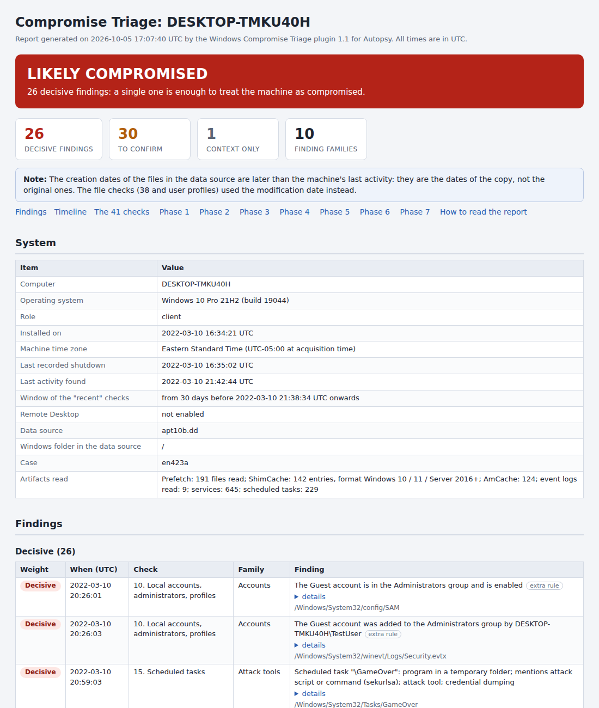
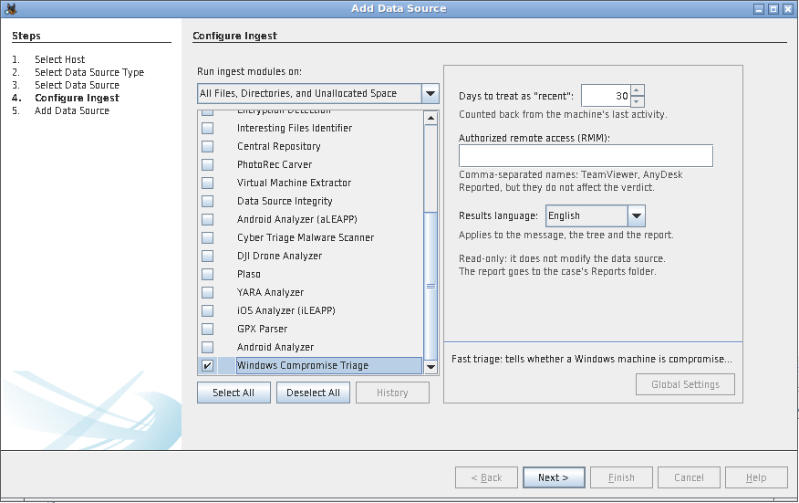
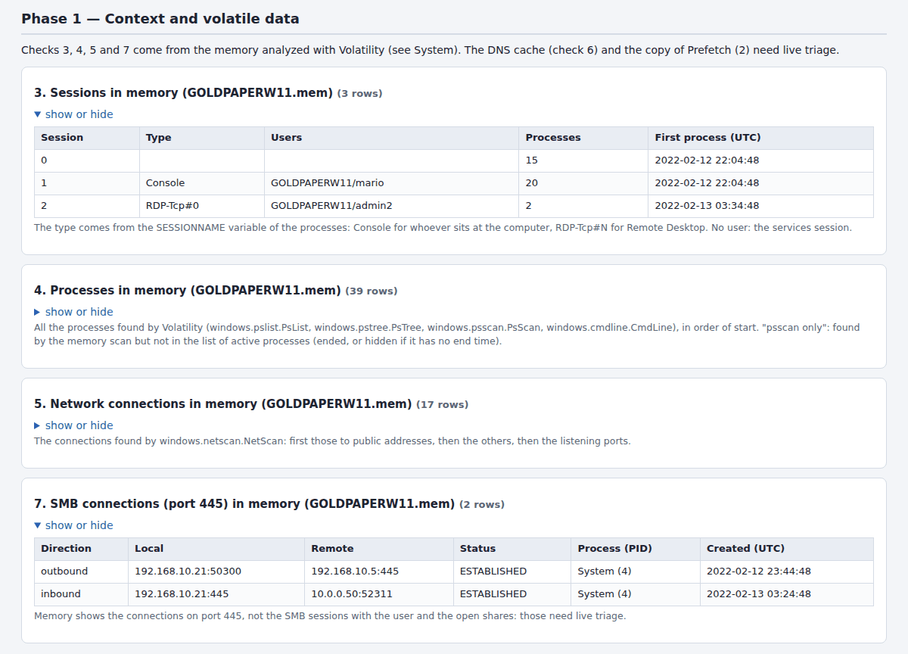
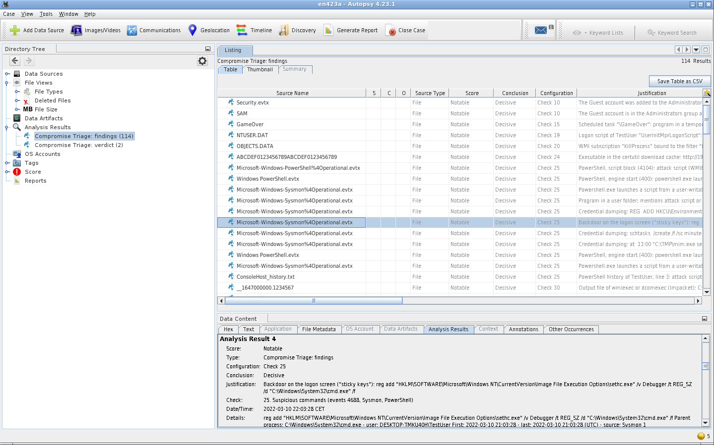

# Windows Compromise Triage for Autopsy

*Windows Compromise Triage* is an ingest module for [Autopsy](https://www.autopsy.com/) that answers one question
in a few minutes: **is this Windows machine compromised, and does it deserve a full forensic analysis?**

Italian version of this page: [README.it.md](README.it.md)

The module runs a 41-point compromise checklist on a disk image or on a set of logical files (and, when a memory
image of the machine is available, on the results of Volatility 3) and gives a verdict:

| Verdict | Meaning |
| --- | --- |
| **LIKELY COMPROMISED** | the machine deserves the full forensic analysis |
| **NEEDS REVIEW** | something has to be clarified, or data is missing |
| **NO INDICATORS FOUND** | the checks that ran found nothing |

The verdict comes with the findings behind it, each one linked in the Autopsy tree to the file it comes from, and
with a self-contained HTML report.



## Contents

- [What it does](#what-it-does)
- [Requirements](#requirements)
- [Installation](#installation)
- [Usage](#usage)
- [Memory (Volatility 3)](#memory-volatility-3)
- [Where the results are](#where-the-results-are)
- [How to read the results](#how-to-read-the-results)
- [The 41 checks](#the-41-checks)
- [Language](#language)
- [Limits](#limits)
- [Tuning the rules](#tuning-the-rules)
- [Development](#development)
- [Compatibility and tests](#compatibility-and-tests)
- [Troubleshooting](#troubleshooting)
- [Credits](#credits)
- [License](#license)

## What it does

The module reads, with its own parsers:

- the registry: `SYSTEM`, `SOFTWARE`, `SAM`, `NTUSER.DAT`, `UsrClass.dat`, `Amcache.hve`, with their transaction logs;
- the event logs (`.evtx`): Security, System, Application, PowerShell, Task Scheduler, Terminal Services, Windows
  Defender, WMI-Activity, Sysmon and a few more;
- Prefetch, scheduled tasks, Startup folders, the WMI repository, `CryptnetUrlCache`, the PowerShell console history;
- the logs of AnyDesk, TeamViewer, LogMeIn and Pulseway, the Windows Defender detection history, the Recycle Bin;
- when a memory image of the machine was acquired: processes, connections and sessions, from the output of
  Volatility 3 collected with the script in `collectors/` (see [Memory](#memory-volatility-3)).

From these it looks for the traces an intrusion usually leaves: cleared logs, new or hidden accounts, logons from
public addresses and password-guessing bursts, persistence (services, scheduled tasks, Run keys, WMI subscriptions),
attack tools and dual-use tools, suspicious command lines, remote execution with Impacket and PsExec, remote access
tools (RMM), antivirus detections, files left in staging folders, anti-forensics.

It needs no other ingest module and no external program (for the memory, Volatility runs outside Autopsy, before
the analysis), and it is read-only: it never modifies the data source.
The results can be produced in English or in Italian.

## Requirements

- Autopsy 4.19 or later (the module uses the analysis results and the scores introduced with 4.19).
- Nothing else: the module is plain Jython 2.7 code and uses only what Autopsy ships with.
- For the memory only: Python 3.8 or later and [Volatility 3](https://github.com/volatilityfoundation/volatility3)
  2.4 or later, on the computer where the memory image is analyzed. Nothing has to be added to Autopsy.

## Installation

1. Download `TriageCompromissione-<version>.zip` from the [releases](../../releases) page and unzip it (or clone
   this repository).
2. In Autopsy open **Tools > Python Plugins**: the folder of the Python modules opens (on Windows it is usually
   `%APPDATA%\autopsy\python_modules`).
3. Copy the whole `TriageCompromissione` folder into it. The result must be
   `...\python_modules\TriageCompromissione\` containing `TriageCompromissione.py` and the `tc_*.py` files.
4. Close and reopen Autopsy.

In the release zip the folder also holds `collectors\collect_memory.py`, the script for the memory image (see
[Memory](#memory-volatility-3)); Autopsy ignores it. In the repository the script is in `collectors/`.

To update, replace the folder and restart Autopsy. A restart is also needed after any change to a `tc_*.py` file:
Autopsy reloads only the main file by itself.

**Coming from version 1.0**: the module was listed as *Triage compromissione Windows* and is now listed as *Windows
Compromise Triage*. Your settings are kept, but the first time Autopsy will tell you that the module with the old
name "could not be found": see [Troubleshooting](#troubleshooting).

## Usage

1. Open or create a case and add the data source (**Add Data Source**):
   - a disk image (E01, dd, vmdk, vhd...), or
   - **Logical Files**: the folder of a triage collection (KAPE, CyLR, Velociraptor...) or a copy of the Windows
     folder. With logical files, tick the timestamp boxes (modified, created, accessed): without them the check on
     recent files cannot tell recent files from old ones and considers them all. The boxes exist from Autopsy 4.21;
     with 4.19 and 4.20 logical files never carry times.
2. In the list of ingest modules tick **Windows Compromise Triage**. It does not need the other modules: for
   triage alone you can leave them all off, which is the fastest way.
3. Settings (the panel on the right when the module is selected; they are remembered for the next runs):
   - **Days to treat as "recent"** (default 30). They are counted back from the machine's last activity, not from
     today.
   - **Authorized remote access (RMM)**: the names of the remote access tools that are authorized on that machine,
     separated by commas (for example `TeamViewer, AnyDesk`). They stay in the report as context but do not affect
     the verdict; a renamed copy of an authorized tool is still reported as a finding to confirm. A name that
     matches no known tool is pointed out in the report.
   - **Results language**: English or Italian, see [Language](#language).
4. Start the ingest. In the tests every machine took from a few seconds to half a minute; a 1 GB Security log adds
   about two minutes.



If the data source holds several Windows installations (several volumes, several machines in the same folder),
each one gets its own verdict and its own report, up to six per data source. Further installations and
`Windows.old` folders are not analyzed: a note in the report says so.

## Memory (Volatility 3)

A disk image does not contain what was running: processes, network connections, logged-on users. If a memory image
of the machine was acquired (on the live machine, before anything else), the module can use it as well. The work is
split in two, so that the verdict always comes from the same engine:

- `collectors/collect_memory.py` **only collects**. It runs a fixed set of Volatility 3 plugins on the memory image
  and keeps their JSON output unchanged, next to a manifest (`compromise-triage-memory.json`) that records the version
  of Volatility, the SHA-256 of the image and how each plugin ended. It judges nothing.
- The **module** finds that folder in the Autopsy case and applies its rules to it, the same rules it applies to the
  disk.

**1. Collect.** On the analysis workstation, never on the suspect machine:

```
py -3 -m pip install volatility3
py -3 collect_memory.py D:\evidence\PC01.mem -o D:\case\PC01_vol3
```

(on Linux and macOS write `python3` instead of `py -3`). The script is in the `collectors` folder of the repository
and of the release zip. `--vol` says how to start Volatility when it is not installed in the same Python (for
example `--vol "py -3 C:\volatility3\vol.py"`); Volatility downloads the symbols of each Windows build from
Microsoft the first time, so on a computer without Internet access use `--symbols` with a local symbol pack and
`--offline`; `--timeout` stops a plugin that runs too long (default 120 minutes); `--no-hash` skips the SHA-256;
`--lang en|it` chooses the language of the messages. Depending on the size of the image it takes from a few minutes
to half an hour.

| Volatility 3 plugin | Used for |
| --- | --- |
| `windows.info` | system time of the acquisition, Windows build |
| `windows.pslist`, `windows.pstree`, `windows.psscan`, `windows.cmdline` | check 4: processes, command lines, parents, hidden processes |
| `windows.netscan` (`windows.netstat` if netscan fails) | checks 5 and 7: connections and their processes |
| `windows.sessions` | check 3: who was logged on, at the console or through Remote Desktop |
| `windows.envars`, `windows.getsids` | the computer name, the user of each process |
| `windows.svcscan` | services in memory that the registry no longer has (checks 17 and 29) |

**2. Add the folder to the case** as **Logical Files**:

- in the same data source as a triage collection of the same machine (KAPE...): put the folder next to it before
  adding it;
- or as a data source of its own, next to the disk image: the module pairs memory and disk by **computer name**
  (the COMPUTERNAME variable of the processes against the name in the registry). The memory of another computer is
  not used: a note in the report says so.

Then run the module on the disk. If the memory is added after the disk was analyzed, run the module on the disk
again: the new results replace the old ones. Run on the memory folder alone, the module gives a verdict from the
memory only, with the coverage warnings for everything a disk would have shown.

**3. What the module finds in memory.**

- With the same rules as on the disk: attack tools and dual-use tools, programs running from folders where programs
  do not belong (`C:\Users\Public`, `PerfLogs`, a `svchost.exe` outside System32...), command lines judged as for
  events 4688 (encoded PowerShell, download and run...), remote access tools (they join checks 32-36), services with
  the signatures of Impacket.
- With rules that make sense only in memory, labeled *extra rule*: a process found by the memory scan but missing
  from the list of active processes (*maybe hidden*), a system process with an unexpected parent or in more than one
  copy, a document program or a web server that starts a command interpreter, a Windows program that does not
  normally talk to the Internet (`rundll32.exe`, `mshta.exe`, `regsvr32.exe`...) with a connection to a public
  address. A Remote Desktop session open at the time of the acquisition is reported as context.
- The report gets the tables of sessions, processes, connections and SMB connections found in memory, and the
  *System* table says which memory image was used, with its SHA-256.



If a Volatility plugin produced nothing, the report says which one and which checks are incomplete, with a coverage
warning: the verdict cannot be "No indicators found". The DNS cache (check 6) and the SMB sessions with their user and
shares cannot be obtained with the standard plugins of Volatility 3: they remain with live triage. Autopsy's
experimental memory data source (Windows only, based on Volatility 2.6) is a different thing and is not needed.

## Where the results are

- **Ingest inbox** (the envelope at the top right): verdict, number of findings, path of the report.
- **Autopsy tree, Analysis Results**:
  - *Compromise Triage: verdict*: one item per machine;
  - *Compromise Triage: findings*: one item per finding, attached to the file it comes from (hive, event log,
    `.pf` file, JSON file of Volatility...). The findings from a memory image kept in another data source are
    attached to the data source that was analyzed.

  Decisive findings have the score *Notable*, findings to confirm *Likely Notable*, so they also show up under
  the *Score* node of the tree (Autopsy 4.21 or later).

  
- **Report**: `<case folder>\Reports\TriageCompromissione\`
  - `Triage_<computer>_<date>.html`: the complete report;
  - `Triage_<computer>_<date>.csv`: the findings only.

  The report is also listed in the tree under **Reports**.

Times in the report are UTC. The only exception, pointed out where it occurs, is the TeamViewer connection log,
which is written in the machine's local time. In the Autopsy tree times follow the time zone chosen in
**Tools > Options > View**.

If you run the module again on the same data source, the old results are replaced by the new ones, except those
you tagged: tagged results are kept. The reports of the previous runs are not deleted.

## How to read the results

Every finding has a **weight**:

| Weight | Meaning | Examples |
| --- | --- | --- |
| **Decisive** | no credible innocent explanation | Mimikatz executed, a service with the smbexec signatures, the Security log cleared, the "sticky keys" backdoor |
| **To confirm** | attackers do it, but administrators do it too | PsExec, an account created from the command line, RDP from a public address, a remote support tool |
| **Informational** | context only: does not affect the verdict (the report groups these findings under *Context only*) | |

and a **family**: Logons, Accounts, Persistence, Program execution, Attack tools, Dual-use tools, Remote
execution, Remote access (RMM), Files, Anti-forensics, Antivirus, Exfiltration and tunneling.

The verdict:

| Situation | Verdict |
| --- | --- |
| at least **one** decisive finding | Likely compromised |
| findings to confirm in **two or more** families | Likely compromised |
| findings to confirm in a single family | Needs review |
| no decisive or to-confirm findings, but at least one coverage warning | Needs review |
| otherwise | No indicators found |

**Coverage warnings** say what the triage could not see: event logs or hives that are missing, damaged or too
short, unreadable files, logs that stop before the other artifacts, checks interrupted by an error. "No indicators
found" is meaningful only when there are no warnings, which is why a warning alone leads to "Needs review".
**Notes** are observations that do not touch the verdict (a clock that was moved, file dates that are those of the
copy...).

The same command weighs differently depending on where it is found. In something that starts by itself (a service,
a scheduled task, a Run key, a WMI subscription) or pasted into the Run dialog, an encoded command or one that
downloads and runs code is decisive. Among commands that were merely executed (events 4688, Sysmon, PowerShell, the
console history) it is only "to confirm", because management tools do similar things every day; only what has no
innocent explanation stays decisive (an attack tool, Impacket's output to `\\127.0.0.1`, a reverse shell...).

"Recent" does not mean close to today. The window is counted back from a reference time: the older of the last
event written to the Security log and the last one written to the System log (if they are missing, the other logs
and the last shutdown time). The report says what it is.

**Every finding counts only until IT explains it.** Triage helps decide whether to dig deeper: it does not replace
the analysis.

## The 41 checks

| No. | Phase | Check |
| --- | --- | --- |
| 1 | 1. Context and volatile data | System context |
| 2-7 | | Prefetch copy, logged-on users, processes, network connections, DNS cache, SMB sessions: steps of live triage, *not applicable to a disk image*; 3, 4, 5 and 7 are also done on a memory image (see [Memory](#memory-volatility-3)) |
| 8 | 2. Accounts and logons | Log coverage and active auditing |
| 9 | | Cleared logs |
| 10 | | Local accounts, administrators, profiles |
| 11 | | Remote network and RDP logons |
| 12 | | Failed logons by address |
| 13 | | Explicit credentials and outbound connections |
| 14 | | RDP sessions (Terminal Services) |
| 15 | 3. Persistence | Scheduled tasks |
| 16 | | Hidden tasks |
| 17 | | Services |
| 18 | | Installed services (event 7045) |
| 19 | | Run keys and Startup folders |
| 20 | | WMI subscriptions |
| 21 | 4. Program execution | Prefetch |
| 22 | | BAM |
| 23 | | RunMRU |
| 24 | | Downloads with certutil |
| 25 | | Suspicious commands (events 4688, Sysmon, PowerShell) |
| 26 | | ShimCache, AmCache, UserAssist |
| 27 | 5. Remote execution with Impacket | Tasks created and deleted within moments |
| 28 | | Signatures of atexec in tasks |
| 29 | | Signatures of smbexec in services |
| 30 | | Leftover files |
| 31 | | Share access (event 5145) |
| 32 | 6. Remote access tools (RMM) | Installed programs |
| 33 | | Portable RMM tools, including renamed ones |
| 34 | | AnyDesk |
| 35 | | TeamViewer |
| 36 | | LogMeIn and Pulseway |
| 37 | 7. Files, antivirus and anti-forensics | Antivirus detections |
| 38 | | Recent files in staging folders |
| 39 | | Recycle Bin |
| 40 | | Shadow copies |
| 41 | | Disabled artifacts |

Checks 2 to 7 belong to live triage. Check 2, the copy of the Prefetch folder, is not needed on an image, because
check 21 reads Prefetch directly. Checks 3 to 7 concern volatile data, which a disk image does not contain: the
report marks them as "Cannot be verified", unless the case holds the results of Volatility 3 on a memory image of
the machine (see [Memory](#memory-volatility-3)); then checks 3, 4, 5 and 7 are done on the memory. All the other
checks are run; the report has a table with the outcome of each one.

Findings labeled **extra rule** come from well-known rules that are not part of the guides the checklist is built
on (sticky keys, Defender exclusions, PowerShell history, port forwarding, hidden accounts...).

## Language

The module speaks English and Italian.

- **Results** (inbox message, tree, HTML report, CSV): the language chosen in the settings panel, *Results
  language*. The first time it is preset to the language of the system; after that it is remembered like the other
  settings.
- **Settings panel and module description**: the language of the system, that is Java's default locale: Italian on
  an Italian system, English everywhere else.
- **Module name**: always *Windows Compromise Triage*. Autopsy recognizes ingest modules by their name in the saved
  ingest settings and in the ingest profiles, so the name does not change with the language.

Two things to know:

- In a case, the names of the two result types in the tree and of their columns are created by the first run and
  keep that language even if a later run uses the other one; the content of the results follows the language of
  each run.
- The CSV file uses the comma as separator in English and the semicolon in Italian, which is what Excel expects
  with the respective regional settings.

## Limits

- ShimCache and AmCache prove that a file existed, not that it was executed: the report says so item by item.
- WMI subscriptions are also searched among the deleted objects of the repository: an entry that is found may no
  longer be active.
- Shadow copies are not opened: the report only says whether they exist.
- Registry transaction logs in the old format (before Windows 8.1) are not applied.
- An IPv6 address is never considered "public".
- Commands obfuscated with `^` or `""` in the middle of words are restored to plain text and encoded PowerShell
  commands are decoded; more elaborate obfuscation is not undone.
- Command lines are visible only if the machine recorded them (event 4688 with the command line, Sysmon, the
  PowerShell logs): Windows does not do it by default. Without them the checks on registry, files, services, tasks,
  Prefetch and logons remain.
- With a partial collection of files the most frequent verdict is "Needs review", with the warnings saying what is
  missing.
- Deleted files are used only where they matter (Impacket leftovers, known tools searched by name).
- Each check keeps at most 40 findings of the same weight and family (160 for decisive ones). When there are
  more, the report says how many there were in all.
- Tools are searched by their known names. A renamed executable is recognized only from its version information,
  which is read for the 400 most recent executables in the staging folders (Downloads, Desktop, Public, Temp,
  ProgramData...).
- Memory is a snapshot of one moment. A process that has already ended is visible only while its structure has not
  been overwritten (psscan), and the command line and the user are missing for the processes whose memory was in the
  paging file. A process *maybe hidden* must be confirmed: the memory scan sometimes finds the remains of a process
  that has just ended.
- In memory, a process name is truncated to 14 characters when Volatility cannot read the full path of the program.

## Tuning the rules

The names and patterns the rules work with are in `TriageCompromissione/tc_regole.py`, in commented lists (the
checks that use them are in the `tc_c_*.py` files):

| List | Content |
| --- | --- |
| `RMM` | remote access tools and how they are recognized |
| `_RX_ATTACCO`, `_NOMI_ATTACCO_ESATTI` | names of attack tools (decisive) |
| `_RX_DOPPIO_USO`, `_NOMI_DOPPIO_ESATTI` | dual-use tools (to confirm) |
| `FRAMMENTI_STRUMENTI` | name fragments used to search the disk for the tools above: a tool added to the lists above is looked for on disk only if a fragment of its name is here too |
| `_RX_PS_ATTACCO` | PowerShell attack scripts and commands |
| `COMANDI` | commands that weigh on their own, with their weight |
| `_NOMI_ANTIVIRUS` | antivirus services and processes |
| `_HOST_PRODUTTORI` | sites from which downloading an installer is normal |
| `_NOTI` | well-known installation scripts (Chocolatey, Scoop...) |
| `_PAROLE_NEI_NOMI` | words that tell a real name from eight random letters |

After a change restart Autopsy and run the tests (see below).

## Development

```
TriageCompromissione/     the plugin: this is the folder to copy into Autopsy
  TriageCompromissione.py   the ingest module (the only file that talks to Autopsy)
  tc_controlli.py           the engine: runs the checks and decides the verdict
  tc_c_registro.py, tc_c_eventi.py, tc_c_file.py   the checks
  tc_regole.py              the rules (lists and command-line evaluation)
  tc_registro.py, tc_evtx.py, tc_prefetch.py, tc_artefatti.py   the parsers
  tc_eventi.py, tc_origine.py, tc_base.py           event collection, data source access, helpers
  tc_memoria.py             the memory: reads the output of Volatility 3 and judges it
  tc_report.py              HTML report and CSV
  tc_lingua.py, tc_lingua_en.py   language selection and the English catalog
collectors/collect_memory.py   runs Volatility 3 on a memory image (Python 3, outside Autopsy)
tests/                    tests of the rule engine (Jython) and of the memory collector (Python 3)
tools/check_translations.py   checks the English catalog against the code
tools/make_release.py     builds the zip file to attach to a release
docs/screenshots/         the images of this page
```

The code, its comments and its identifiers are in Italian, the language the plugin was born in. Every text shown
to the analyst is written in Italian in the code, wrapped in `tr(u'...')`, and has its English translation in
`tc_lingua_en.py`; `N_(u'...')` only marks a text defined once at import time, which is then translated with `tr()`
where it is shown.

The source files must stay pure ASCII: accented letters are written as `\uXXXX` escapes (for example `\u00e8`
for "è"), the safest form with Jython 2.7.

**Checking the translations** (Python 3.8 or later):

```
python3 tools/check_translations.py
```

(on Windows: `py -3 tools\check_translations.py`)

It reports the texts that have no English translation, the translations that are no longer used and those whose
placeholders (`%s`, `%d`...) or HTML tags differ from the Italian text.

**Running the tests** needs only Java and the Jython jar. The jar is inside every Autopsy installation; on Windows
Autopsy also ships its own Java:

```
"C:\Program Files\Autopsy-4.23.1\jre\bin\java.exe" -jar "C:\Program Files\Autopsy-4.23.1\autopsy\modules\ext\jython-standalone-2.7.4.jar" tests\run_tests.py
```

(adjust the two paths to your version of Autopsy; in PowerShell put `&` in front of the command; on Linux and
macOS use `java -jar .../jython-standalone-2.7.4.jar tests/run_tests.py`). The tests feed several hundred command
lines, service definitions and synthetic timestamps to the rule engine and compare the outcome with the expected
one, in both languages. They need neither Autopsy nor any evidence file.

**Testing the memory collector** needs Python 3.8 or later, and neither Volatility nor a memory image: a small fake
Volatility answers like the real one, including its failures:

```
python3 tests/test_collect_memory.py
```

See [CONTRIBUTING.md](CONTRIBUTING.md) for the few rules to follow when changing the code. To report a
security problem, follow [SECURITY.md](SECURITY.md): privately, not in a public issue.

## Compatibility and tests

- Autopsy 4.19 or later.
- The engine was tested with Jython 2.7.2 (Autopsy 4.19-4.21) and 2.7.4 (Autopsy 4.22-4.23), with identical
  results, on real artifacts of seven healthy and compromised machines, on a collection of event logs of attacks
  and on damaged copies of the same files. In Italian the results of version 1.1 are identical to those of
  version 1.0, apart from the few corrected texts listed in the changelog; in English they have the same findings,
  weights, families and verdicts.
- The complete plugin was tested inside Autopsy 4.21.0 and 4.23.1, in both languages: from the command line on a
  disk image and on logical files, and from the graphical interface on a disk image (Add Data Source wizard and Run
  Ingest Modules window with the settings panel, ingest, inbox, results tree, list of reports). The update from
  version 1.0 was tested too: the saved settings, ingest settings that still name the old module, and a case that
  already holds the results of version 1.0.
- Memory (version 1.2): the module was tested on the output of Volatility 3 for synthetic machines, produced with
  Volatility's own classes (the real column definitions of each plugin and its JSON renderer) and with the columns
  of the versions from 2.4 to 2.28; inside Autopsy 4.21.0 and 4.23.1, with the memory in the same data source as the
  disk files and in a data source of its own. The collector was tested with a fake Volatility (success, failures,
  timeouts, interruption) and with Volatility 3 2.28.2 on a file that is not a memory image. It was **not** tested on
  a real memory image: on the first real case, compare its findings with the JSON files of Volatility, which are next
  to the manifest. Without memory, the results of version 1.2 are identical to those of version 1.1 apart from the
  note on checks 3-7.
- These tests were done on Linux. Autopsy on Windows was **not** part of them: the program is the same, but fonts
  and window sizes may differ. Versions 4.19, 4.20 and 4.22 were not tested end to end: for those, the source code
  of Autopsy and of The Sleuth Kit was checked for the functions the plugin uses. On the first run, check that the
  module is listed and that the report is created.

The tests on real artifacts use public forensic images and collections that are not part of this repository: the
repository contains the tests that need no evidence files.

## Troubleshooting

- **The module is not in the list**: the folder is not in the right place (it must be
  `python_modules\TriageCompromissione\`) or Autopsy was not restarted.
- **"Previously loaded Triage compromissione Windows module could not be found"**: you updated from version 1.0,
  where the module had that name. Press OK: the module is in the list as *Windows Compromise Triage*, already
  ticked, with the settings you had. Autopsy shows the notice once for each place where it had saved the old name
  (the Add Data Source wizard, the Run Ingest Modules window, each ingest profile). If you run the ingest from the
  command line (`--runIngest`), the first run after the update ends with "Error running ingest on data source" and
  writes the same notice in the log; it also corrects the saved settings, so the next run works.
- **"Triage failed on ..."**: the message in the ingest inbox shows the error. The details are in the Autopsy log
  (**Help > Open Log Folder**, file `autopsy.log.0`, search for "Triage").
- **"Triage: no Windows artifacts in ..."**: the data source has no `Windows\System32\config` folder and no
  recognizable `.evtx` files or hives.
- **Checks 3-7 still say "Cannot be verified" although the memory is in the case**: the module looks for the file
  `compromise-triage-memory.json` written by the collector. Either the memory belongs to another computer (the
  report has a note with both names), or it was added to the case after the disk was analyzed: run the module on the
  disk again.
- **collect_memory.py stops at the first plugin with "Unsatisfied requirement"**: Volatility found neither a Windows
  kernel nor its symbols. Check that the file is a memory image of Windows; without Internet access, give Volatility
  the symbol pack with `--symbols`.
- **The report says some checks were interrupted by an error**: the other checks ran anyway; if there are no
  findings the verdict is "Needs review" instead of "No indicators found". Please open an issue with the error
  text.

## Credits

The checklist behind the 41 checks is built on the 32 guides collected by Cyber Triage in the post
[Windows Artifact Forensics Guides – The Master List](https://www.linkedin.com/posts/cyber-triage_windows-artifact-forensics-guides-the-master-activity-7503822145521635328-H3iC)
(10 September 2026), plus Cyber Triage's guide
[How to Find WMI Consumers](https://www.cybertriage.com/blog/how-to-find-wmi-consumers/) for check 20.

The memory analysis relies on [Volatility 3](https://github.com/volatilityfoundation/volatility3) by the Volatility
Foundation, which is installed separately and distributed under its own license: this project does not include it.

This project is independent: it is not affiliated with, nor endorsed by, Cyber Triage, Sleuth Kit Labs, the
Volatility Foundation or the Autopsy project.

## License

Copyright 2026 Davide Numelli

Licensed under the [Apache License, Version 2.0](LICENSE). The software is provided "as is", without warranties of
any kind: it is a triage aid, and its verdict is not a substitute for the judgment of an analyst.

**Author**: Davide Numelli — GitHub [@numdav](https://github.com/numdav)
