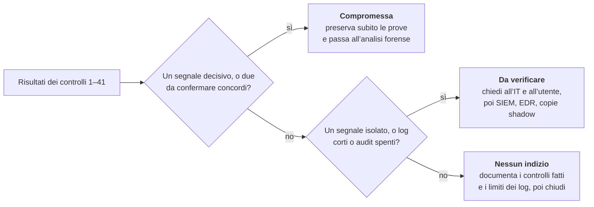

# Checklist di triage: questa macchina Windows è compromessa?

30 settembre 2026 · Davide Numelli

In 41 controlli, da eseguire in ordine su una macchina Windows accesa, questa checklist ti dice se trattarla come compromessa e passare all'analisi forense completa. Le fasi vanno dai dati che spariscono prima a quelli più stabili. I rimandi «scheda 1.3» portano al documento di studio [Guide forensi agli artefatti Windows — documento di studio](guide-forensi-artefatti-windows.md).

I comandi sono per Windows PowerShell 5.1, in una console aperta come amministratore. Salvano tutto in `E:\caso`, su un'unità esterna: se ha un'altra lettera, cambiala in ogni comando. Li ho controllati nella sintassi e provati su dati di esempio, non su un Windows reale: provali prima su una macchina di test.

## Prima di iniziare

Il triage si fa a macchina accesa e ogni tua azione modifica il sistema: queste regole limitano il danno.

- **Non spegnere e non riavviare.** All'avvio BAM cancella le voci più vecchie di 7 giorni e quelle degli eseguibili cancellati (scheda 1.3). ShimCache vive in memoria fino allo spegnimento (scheda 1.2); cache DNS, sessioni e memoria si perdono (schede 3.2 e 3.5). Se devi isolare la macchina, scollega la rete, non la corrente.
- **Se puoi, acquisisci prima la RAM.** Solo l'analisi della memoria vede anche ciò che un rootkit nasconde (scheda 3.2).
- **Lavora dalla riga di comando.** Navigare con Esplora risorse crea Shellbags e avviare programmi dalla GUI crea voci UserAssist (schede 1.8 e 1.10): tracce tue, mescolate a quelle dell'attaccante.
- **Salva tutto fuori dalla macchina,** su un'unità esterna. Scrivere sul disco sospetto può sovrascrivere file cancellati ancora recuperabili (schede 4.1 e 4.3).
- **Registra quello che fai.** Il controllo 1 avvia `Start-Transcript`, che salva comandi e risultati; anche i tuoi comandi finiscono nel Prefetch e negli event log (schede 1.1 e 6.1).
- **Fermati al primo segnale decisivo** (sezione Decisione) e passa a «Se approfondisci»: ogni comando in più altera la macchina.
- **Chiedi subito le copie centralizzate** dei log a SIEM, EDR o Windows Event Forwarding: i log locali sono necessari ma non sufficienti (scheda 6.1).

## Fase 1 — Dati volatili e contesto

Qui raccogli ciò che sparisce per primo o che i tuoi stessi comandi alterano.

- [ ] **1. Cartella del caso, trascrizione, ora di sistema.** Crea le cartelle, avvia la trascrizione, annota nome del computer, ora, fuso e ultimo avvio. Confronta l'ora con un orologio affidabile e annota lo scarto: servirà per allineare la timeline.

```powershell
New-Item -ItemType Directory E:\caso, E:\caso\out -Force | Out-Null
Start-Transcript -Path E:\caso\sessione.txt
Get-Date; Get-TimeZone
Get-CimInstance Win32_OperatingSystem | Select-Object CSName, Caption, BuildNumber, InstallDate, LastBootUpTime
```

- [ ] **2. Copia del Prefetch.** Da Windows 8 la cartella tiene al massimo 1024 file e ogni programma che lanci ne crea o ne aggiorna uno: copiala prima di andare avanti. Sui Windows Server il Prefetch è spento di default, quindi la cartella può essere vuota (scheda 1.1).

```powershell
robocopy C:\Windows\Prefetch E:\caso\Prefetch *.pf /COPY:DAT
```

- [ ] **3. Utenti collegati ora.** **Allarme:** sessioni di utenti che non dovrebbero esserci, o sessioni RDP attive da origini sconosciute (scheda 3.2).

```powershell
quser
```

- [ ] **4. Processi con riga di comando e processo padre.** Salva l'elenco in CSV per le fasi successive. **Allarme:** eseguibili in `Temp`, `AppData`, `Users\Public` o `ProgramData`; nomi di processi di sistema fuori da `System32`; `cmd` o PowerShell figli di programmi inattesi; strumenti RMM in esecuzione (schede 1.5, 3.3 e 5.1).

```powershell
Get-CimInstance Win32_Process |
  Select-Object ProcessId, ParentProcessId, Name, ExecutablePath, CommandLine, CreationDate |
  Export-Csv E:\caso\processi.csv -NoTypeInformation -Encoding UTF8
```

- [ ] **5. Connessioni di rete con il processo proprietario.** **Allarme:** connessioni stabilite verso IP esterni da processi insoliti; la porta 5938, usata da TeamViewer (scheda 5.5); porte in ascolto che non sai spiegare.

```powershell
Get-NetTCPConnection -State Established, Listen |
  Select-Object LocalAddress, LocalPort, RemoteAddress, RemotePort, State, OwningProcess,
    @{n='Processo'; e={ (Get-Process -Id $_.OwningProcess -ErrorAction SilentlyContinue).Path }} |
  Export-Csv E:\caso\connessioni.csv -NoTypeInformation -Encoding UTF8
```

- [ ] **6. Cache DNS.** Sopravvive alla navigazione in incognito, non al riavvio (scheda 3.5). La seconda riga cerca i domini degli RMM. **Allarme:** domini di AnyDesk, TeamViewer, LogMeIn o Pulseway dove quegli strumenti non sono autorizzati (schede 5.2–5.5).

```powershell
Get-DnsClientCache | Select-Object Entry, Data | Export-Csv E:\caso\dns.csv -NoTypeInformation -Encoding UTF8
Get-DnsClientCache | Where-Object Entry -match 'anydesk|teamviewer|logmein|pulseway' | Select-Object Entry, Data
```

- [ ] **7. Sessioni e connessioni SMB.** `Get-SmbSession` mostra chi è collegato alle condivisioni di questa macchina; `Get-SmbConnection` e `net use` mostrano a cosa si collega lei. **Allarme:** client o account inattesi, condivisioni amministrative come `C$` e `ADMIN$` aperte da altri host (schede 1.6 e 1.7).

```powershell
Get-SmbSession | Select-Object ClientComputerName, ClientUserName, NumOpens
Get-SmbConnection
net use
```

## Fase 2 — Account e accessi

Prima di cercare eventi, verifica quanto indietro arrivano i log: «nessun evento» non vuol dire «nessuna attività». I comandi della fase usano `$inizio`, cioè gli ultimi 14 giorni: se apri una nuova finestra di PowerShell, riesegui la prima riga del controllo 8.

- [ ] **8. Copertura dei log e audit attivi.** Mostra se i log principali sono attivi e quanti eventi hanno, l'evento più vecchio del Security, gli archivi e la policy di audit. **Allarme:** un Security che copre poche ore o pochi giorni, log disattivati, audit spento dove la policy aziendale lo prevede. Il log di Terminal Services conserva spesso periodi molto più lunghi del Security (schede 3.2 e 6.1).

```powershell
$inizio = (Get-Date).AddDays(-14)
Get-WinEvent -ListLog Security, System, 'Microsoft-Windows-TaskScheduler/Operational', 'Microsoft-Windows-TerminalServices-LocalSessionManager/Operational' |
  Select-Object LogName, IsEnabled, RecordCount, MaximumSizeInBytes
(Get-WinEvent -LogName Security -Oldest -MaxEvents 1).TimeCreated
Get-ChildItem C:\Windows\System32\winevt\Logs\Archive-* -ErrorAction SilentlyContinue
auditpol /get /category:*
```

- [ ] **9. Log cancellati.** Cancellare il Security lascia l'evento 1102 nel log nuovo; cancellare un altro log lascia il 104 nel System. **Allarme:** qualsiasi 1102 o 104 fuori da una manutenzione nota: servono diritti di amministratore, ed è un segnale forte (scheda 6.1).

```powershell
Get-WinEvent -FilterHashtable @{LogName='Security'; Id=1102} -ErrorAction SilentlyContinue | Select-Object TimeCreated, Message
Get-WinEvent -FilterHashtable @{LogName='System'; Id=104} -ErrorAction SilentlyContinue | Select-Object TimeCreated, Message
```

- [ ] **10. Account locali, amministratori, profili.** La data di creazione della cartella di un profilo approssima il primo accesso di quell'utente alla macchina. Se `Get-LocalGroupMember` dà errore (succede con SID orfani nel gruppo), usa la riga di riserva in fondo. **Allarme:** account nuovi o fuori dalla convenzione aziendale, account locali che imitano i nomi di dominio, amministratori non previsti, profili creati di recente (scheda 3.1).

```powershell
Get-LocalUser | Select-Object Name, Enabled, LastLogon, PasswordLastSet, Description
Get-LocalGroupMember -SID S-1-5-32-544
Get-ChildItem C:\Users -Directory -Force | Select-Object Name, CreationTime, LastWriteTime
# se Get-LocalGroupMember dà errore, togli il # dalla riga seguente:
# net localgroup (Get-CimInstance Win32_Group -Filter "LocalAccount=True AND SID='S-1-5-32-544'").Name
```

- [ ] **11. Logon remoti di rete e RDP.** Estrae dai 4624 i logon di tipo 3 (rete) e 10 (RDP) con utente, IP, host e processo, e li salva in CSV. Su un server molto usato può richiedere qualche minuto: in quel caso riduci i giorni in `$inizio`. **Allarme:** account senza motivo di accedere, utenti noti da host o in orari inattesi, un account che ha iniziato ad accedere di recente (schede 3.2 e 3.4).

```powershell
Get-WinEvent -FilterHashtable @{LogName='Security'; Id=4624; StartTime=$inizio} -ErrorAction SilentlyContinue | ForEach-Object {
  $e = $_; $d = @{}
  ([xml]$e.ToXml()).Event.EventData.Data | ForEach-Object { $d[$_.Name] = $_.'#text' }
  [pscustomobject]@{ Ora = $e.TimeCreated; Utente = "$($d.TargetDomainName)\$($d.TargetUserName)"; Tipo = $d.LogonType
                     IP = $d.IpAddress; Host = $d.WorkstationName; Processo = $d.ProcessName }
} | Where-Object { $_.Tipo -in '3', '10' -and $_.IP -notin '-', '::1', '127.0.0.1' } |
  Export-Csv E:\caso\logon_remoti.csv -NoTypeInformation -Encoding UTF8
```

- [ ] **12. Accessi falliti per indirizzo.** Conta i 4625 per IP di origine. **Allarme:** raffiche da un solo indirizzo (brute force), soprattutto se seguite da un 4624 riuscito dallo stesso IP (scheda 3.2).

```powershell
Get-WinEvent -FilterHashtable @{LogName='Security'; Id=4625; StartTime=$inizio} -ErrorAction SilentlyContinue | ForEach-Object {
  ([xml]$_.ToXml()).Event.EventData.Data | Where-Object Name -eq 'IpAddress' | ForEach-Object { $_.'#text' }
} | Group-Object | Sort-Object Count -Descending | Select-Object -First 20 Count, Name
```

- [ ] **13. Credenziali esplicite e connessioni in uscita.** Il 4648 registra un logon con credenziali esplicite, diverse da quelle della sessione. Le chiavi `Terminal Server Client` e `MountPoints2` mostrano a quali server RDP e condivisioni si sono collegati gli utenti. **Allarme:** accessi verso host che quell'utente non usa, account remoto diverso da quello locale (schede 2.1, 3.2 e 6.1).

```powershell
Get-WinEvent -FilterHashtable @{LogName='Security'; Id=4648; StartTime=$inizio} -ErrorAction SilentlyContinue | Select-Object TimeCreated, Message
Get-ChildItem 'Registry::HKEY_USERS\*\Software\Microsoft\Terminal Server Client\Servers' -ErrorAction SilentlyContinue |
  Select-Object Name, @{n='Utente'; e={ $_.GetValue('UsernameHint') }}
Get-ChildItem 'Registry::HKEY_USERS\*\Software\Microsoft\Windows\CurrentVersion\Explorer\MountPoints2' -ErrorAction SilentlyContinue |
  Where-Object PSChildName -like '##*' | Select-Object Name
```

- [ ] **14. Sessioni RDP (Terminal Services).** Eventi 21, 22, 24 e 25: logon, avvio della shell, disconnessione e riconnessione, spesso con l'indirizzo di origine. **Allarme:** sessioni da indirizzi esterni o sconosciuti, o in orari insoliti (scheda 6.1).

```powershell
Get-WinEvent -FilterHashtable @{LogName='Microsoft-Windows-TerminalServices-LocalSessionManager/Operational'; Id=21,22,24,25} -ErrorAction SilentlyContinue |
  Select-Object TimeCreated, Id, Message
```

## Fase 3 — Persistenza

Chi vuole restare sulla macchina lascia qualcosa che riparte da solo: attività pianificate, servizi, chiavi Run, sottoscrizioni WMI.

- [ ] **15. Attività pianificate.** Esporta le attività con le loro azioni e mostra i file più recenti in `C:\Windows\System32\Tasks`. **Allarme:** attività create negli ultimi 30 giorni, eseguibili in posizioni insolite, azioni che lanciano file `.lnk`, nomi di 8 lettere casuali nella cartella radice (schede 1.6 e 2.4).

```powershell
Get-ScheduledTask | Select-Object TaskPath, TaskName, State, Author, Date,
  @{n='Azioni'; e={ ($_.Actions | ForEach-Object { "$($_.Execute) $($_.Arguments)" }) -join ' ; ' }} |
  Export-Csv E:\caso\attivita.csv -NoTypeInformation -Encoding UTF8
Get-ChildItem C:\Windows\System32\Tasks -Recurse -File -Force -ErrorAction SilentlyContinue |
  Sort-Object CreationTime -Descending | Select-Object -First 30 FullName, CreationTime
```

- [ ] **16. Attività nascoste.** Il gruppo HAFNIUM (malware Tarrask) ha nascosto attività agli strumenti standard cancellando il valore `SD` sotto `TaskCache\Tree`; anche un `Index` portato a 0 nasconde l'attività. Il comando elenca le attività senza `SD` e quelle con `Index` a 0 che hanno ancora la propria scheda sotto `TaskCache\Tasks`. Un `Index` a 0 senza scheda è normale: ogni Windows 10 ne ha qualche decina. Il controllo vale da Windows 10 e Server 2016 in poi, perché prima `SD` manca in tutte le attività. **Allarme:** qualsiasi risultato (scheda 2.4).

```powershell
$tc = 'HKLM:\SOFTWARE\Microsoft\Windows NT\CurrentVersion\Schedule\TaskCache'
$build = [int](Get-ItemProperty 'HKLM:\SOFTWARE\Microsoft\Windows NT\CurrentVersion').CurrentBuildNumber
if ($build -lt 10240) { "Build ${build}: prima di Windows 10 questo controllo non si applica" } else {
  Get-ChildItem "$tc\Tree" -Recurse -ErrorAction SilentlyContinue | ForEach-Object {
    $id = $_.GetValue('Id'); if (-not $id) { return }
    $senzaSD = $_.GetValueNames() -notcontains 'SD'
    $index0 = ($_.GetValue('Index') -eq 0) -and (Test-Path -LiteralPath "$tc\Tasks\$id")
    if ($senzaSD -or $index0) {
      [pscustomobject]@{ Attivita = $_.Name -replace '^.*?\\TaskCache\\Tree', ''; SenzaSD = $senzaSD; Index0ConScheda = $index0 }
    }
  }
}
```

- [ ] **17. Servizi.** Esporta tutti i servizi, poi mostra quelli il cui binario è `cmd.exe`, `%COMSPEC%`, PowerShell o un file in `Users` o `Temp`. **Allarme:** qualsiasi risultato della seconda parte: è la regola generica per l'esecuzione tramite servizi (scheda 1.7).

```powershell
Get-CimInstance Win32_Service | Select-Object Name, DisplayName, State, StartMode, StartName, PathName |
  Export-Csv E:\caso\servizi.csv -NoTypeInformation -Encoding UTF8
Get-CimInstance Win32_Service |
  Where-Object { $_.PathName -match 'cmd\.exe|%COMSPEC%|powershell|pwsh|__output|\\Users\\|\\Temp\\' } |
  Select-Object Name, StartName, PathName
```

- [ ] **18. Servizi installati (evento 7045).** Mostra nome, percorso e account di ogni servizio installato, poi gli errori 7009 di timeout all'avvio. **Allarme:** nomi casuali, binari in percorsi utente, 7045 seguiti da 7009 (tipico di smbexec, scheda 1.7), strumenti RMM installati come servizio (scheda 5.2).

```powershell
Get-WinEvent -FilterHashtable @{LogName='System'; Id=7045} -ErrorAction SilentlyContinue |
  Select-Object TimeCreated, @{n='Servizio'; e={$_.Properties[0].Value}}, @{n='Percorso'; e={$_.Properties[1].Value}}, @{n='Account'; e={$_.Properties[4].Value}}
Get-WinEvent -FilterHashtable @{LogName='System'; Id=7009} -ErrorAction SilentlyContinue | Select-Object TimeCreated, Message
```

- [ ] **19. Chiavi Run e cartelle Esecuzione automatica.** Sotto `HKEY_USERS` ci sono solo gli utenti collegati: per gli altri serve il loro `NTUSER.DAT`, offline (schede 2.1 e 2.3). **Allarme:** voci che puntano ad `AppData`, `Temp` o `Users\Public`, a script o a comandi PowerShell; file recenti nelle cartelle Esecuzione automatica (scheda 1.5).

```powershell
Get-ItemProperty 'HKLM:\SOFTWARE\Microsoft\Windows\CurrentVersion\Run',
  'HKLM:\SOFTWARE\Microsoft\Windows\CurrentVersion\RunOnce',
  'HKLM:\SOFTWARE\WOW6432Node\Microsoft\Windows\CurrentVersion\Run',
  'HKLM:\SOFTWARE\WOW6432Node\Microsoft\Windows\CurrentVersion\RunOnce',
  'Registry::HKEY_USERS\*\Software\Microsoft\Windows\CurrentVersion\Run',
  'Registry::HKEY_USERS\*\Software\Microsoft\Windows\CurrentVersion\RunOnce' -ErrorAction SilentlyContinue | Format-List
Get-ChildItem 'C:\Users\*\AppData\Roaming\Microsoft\Windows\Start Menu\Programs\Startup',
  'C:\ProgramData\Microsoft\Windows\Start Menu\Programs\StartUp' -Force -ErrorAction SilentlyContinue |
  Select-Object FullName, CreationTime, LastWriteTime
```

- [ ] **20. Sottoscrizioni WMI (fuori dal post).** Un consumer WMI legato a un filtro esegue un comando o uno script quando si verifica un evento: una persistenza senza file evidenti. **Allarme:** consumer di tipo `CommandLineEventConsumer` o `ActiveScriptEventConsumer` con comandi o script che non sai spiegare (vedi Fonti).

```powershell
foreach ($ns in 'root\subscription', 'root\default') {
  Get-CimInstance -Namespace $ns -ClassName __EventConsumer -ErrorAction SilentlyContinue |
    Select-Object @{n='Namespace'; e={$ns}}, @{n='Classe'; e={$_.CimClass.CimClassName}}, Name, CommandLineTemplate, ExecutablePath, ScriptText | Format-List
  Get-CimInstance -Namespace $ns -ClassName __FilterToConsumerBinding -ErrorAction SilentlyContinue |
    Select-Object @{n='Namespace'; e={$ns}}, Filter, Consumer | Format-List
}
```

## Fase 4 — Programmi eseguiti

Nessun artefatto di esecuzione basta da solo: incrocia quello che trovi tra un controllo e l'altro.

- [ ] **21. Prefetch.** Mostra i 60 file più recenti; PECmd analizza la copia fatta al controllo 2. PECmd, AppCompatCacheParser e RBCmd sono strumenti gratuiti di Eric Zimmerman: tienili sull'unità esterna e lanciali con il percorso completo. Il `.pf` viene scritto circa 10 secondi dopo l'avvio del programma. **Allarme:** strumenti di ricognizione come `whoami`, `net` o `nltest`, PsExec, archiviatori, strumenti RMM, eseguibili con nomi casuali; un Prefetch vuoto o quasi su un client (schede 1.1 e 3.4).

```powershell
Get-ChildItem C:\Windows\Prefetch -Filter *.pf | Sort-Object LastWriteTime -Descending |
  Select-Object -First 60 Name, CreationTime, LastWriteTime
PECmd.exe -d E:\caso\Prefetch --csv E:\caso\out --csvf prefetch.csv
```

- [ ] **22. BAM.** Per ogni utente, gli eseguibili con l'ora dell'ultimo avvio in UTC. Non registra programmi avviati da supporti rimovibili, da condivisioni di rete o in esecuzione remota, e l'orario può scostarsi di qualche minuto. **Allarme:** eseguibili in `Temp`, `Downloads`, `AppData` o `Users\Public` nella finestra sospetta (scheda 1.3).

```powershell
Get-ChildItem 'HKLM:\SYSTEM\CurrentControlSet\Services\bam\State\UserSettings',
  'HKLM:\SYSTEM\CurrentControlSet\Services\bam\UserSettings' -ErrorAction SilentlyContinue | ForEach-Object {
  $k = $_
  foreach ($v in $k.GetValueNames()) {
    $b = $k.GetValue($v)
    if ($b -is [byte[]] -and $b.Length -ge 8) {
      [pscustomobject]@{ SID = $k.PSChildName; Eseguibile = $v
                         UltimaUTC = [DateTime]::FromFileTimeUtc([BitConverter]::ToInt64($b, 0)) }
    }
  }
} | Sort-Object UltimaUTC -Descending
```

- [ ] **23. RunMRU.** I comandi digitati o incollati nella finestra Esegui (Win+R); il valore `MRUList` dà l'ordine, dal più recente. **Allarme:** PowerShell, `mshta`, `curl` o URL incollati: è lo schema delle finte CAPTCHA (tecnica ClickFix) e dei falsi supporti tecnici (scheda 1.9).

```powershell
Get-ItemProperty 'Registry::HKEY_USERS\*\Software\Microsoft\Windows\CurrentVersion\Explorer\RunMRU' -ErrorAction SilentlyContinue | Format-List
```

- [ ] **24. Download con certutil.** Certutil conserva una copia di ciò che scarica in `CryptnetUrlCache\Content`, anche se l'originale è stato cancellato. Il comando cerca i file che iniziano con i byte 77 e 90 (`MZ`), cioè gli eseguibili Windows. Il file con lo stesso nome nella cartella `MetaData` accanto contiene l'URL di origine: aprilo con `Format-Hex`. **Allarme:** qualsiasi eseguibile, perché la cartella di norma contiene solo CRL e risposte OCSP (scheda 1.4).

```powershell
Get-ChildItem 'C:\Users\*\AppData\LocalLow\Microsoft\CryptnetUrlCache\Content',
  'C:\Windows\*\config\systemprofile\AppData\LocalLow\Microsoft\CryptnetUrlCache\Content',
  'C:\Windows\ServiceProfiles\*\AppData\LocalLow\Microsoft\CryptnetUrlCache\Content' -File -Force -ErrorAction SilentlyContinue |
  Where-Object { try { $b = [IO.File]::ReadAllBytes($_.FullName) } catch { $b = $null }
                 $b.Length -ge 2 -and $b[0] -eq 77 -and $b[1] -eq 90 } |
  Select-Object FullName, Length, LastWriteTime
```

- [ ] **25. Comandi sospetti negli eventi 4688.** Funziona solo se è attivo l'audit della creazione dei processi con la riga di comando, spento di default (controllo 8). **Allarme:** `certutil` con un URL; `curl` che salva in cartelle scrivibili, con percorsi assoluti o estensioni cambiate; `whoami`; `vssadmin` o `shadowcopy` (cancellazione delle copie shadow); le firme di Impacket della fase 5 (schede 1.4, 1.5, 4.2 e 6.1).

```powershell
Get-WinEvent -FilterHashtable @{LogName='Security'; Id=4688; StartTime=$inizio} -ErrorAction SilentlyContinue |
  Where-Object { $_.Message -match 'certutil|curl|__output|\.tmp 2>&1|vssadmin|shadowcopy|call create|whoami' } |
  Select-Object TimeCreated, Message
```

- [ ] **26. ShimCache (facoltativo).** Salva l'hive `SYSTEM` e lo analizza con AppCompatCacheParser. La cache viene scritta nel registro solo allo spegnimento, quindi qui vedi la situazione dell'ultimo spegnimento. Da Windows 10 prova che un file esisteva, non che è stato eseguito (scheda 1.2).

```powershell
reg save HKLM\SYSTEM E:\caso\SYSTEM.hiv /y
AppCompatCacheParser.exe -f E:\caso\SYSTEM.hiv --csv E:\caso\out
```

## Fase 5 — Esecuzione remota con Impacket

atexec e smbexec eseguono comandi da remoto con attività pianificate e servizi temporanei. Molte loro firme dipendono da audit spenti di default (controllo 8): trovarle è significativo, non trovarle non esclude nulla.

- [ ] **27. Attività create e cancellate in pochi istanti.** Accoppia creazione e cancellazione della stessa attività nel Security (4698 e 4699) e, se è attivo, nel log TaskScheduler (106 e 141), e mostra quelle durate meno di un minuto. **Allarme:** coppie sotto il secondo: atexec crea e cancella l'attività entro 500 ms, come ogni esecuzione remota con attività temporanee (scheda 1.6).

```powershell
$fonti = @{ Log = 'Security'; Crea = 4698; Canc = 4699; Nome = 4 },
         @{ Log = 'Microsoft-Windows-TaskScheduler/Operational'; Crea = 106; Canc = 141; Nome = 0 }
foreach ($f in $fonti) {
  Get-WinEvent -FilterHashtable @{LogName=$f.Log; Id=$f.Crea, $f.Canc} -ErrorAction SilentlyContinue |
    Group-Object { $_.Properties[$f.Nome].Value } | ForEach-Object {
      $g = $_
      $c = $g.Group | Where-Object Id -eq $f.Crea | Select-Object -Last 1
      $x = $g.Group | Where-Object Id -eq $f.Canc | Select-Object -Last 1
      if ($c -and $x) {
        [pscustomobject]@{ Log = $f.Log; Attivita = $g.Name; Creata = $c.TimeCreated
                           Millisecondi = [int]($x.TimeCreated - $c.TimeCreated).TotalMilliseconds }
      }
    } | Where-Object { $_.Millisecondi -ge 0 -and $_.Millisecondi -lt 60000 }
}
```

- [ ] **28. Firme di atexec nel 4698.** Cerca nell'XML dell'attività la data fissa `2015-07-15T20:35:13` scritta nel codice di atexec, oppure un output verso un file `.tmp` di 8 lettere in `Temp`. **Allarme:** qualsiasi risultato; la prima firma ha affidabilità molto alta (scheda 1.6).

```powershell
Get-WinEvent -FilterHashtable @{LogName='Security'; Id=4698} -ErrorAction SilentlyContinue |
  Where-Object { $_.Properties[5].Value -match '2015-07-15T20:35:13|Temp\\[A-Za-z]{8}\.tmp' } |
  Select-Object TimeCreated, @{n='Attivita'; e={$_.Properties[4].Value}}
```

- [ ] **29. Firme di smbexec nei servizi installati.** Cerca nei 7045 e nei 4697 `__output`, `echo cd`, `execute.bat`, `%COMSPEC%` o il vecchio nome di servizio `BTOBTO`; dal 2023 servizio e batch hanno nomi di 8 lettere casuali. **Allarme:** qualsiasi risultato (scheda 1.7).

```powershell
Get-WinEvent -FilterHashtable @{LogName='System'; Id=7045} -ErrorAction SilentlyContinue |
  Where-Object { $_.Properties[1].Value -match '__output|echo cd|execute\.bat|%COMSPEC%' -or $_.Properties[0].Value -eq 'BTOBTO' } |
  Select-Object TimeCreated, @{n='Servizio'; e={$_.Properties[0].Value}}, @{n='Percorso'; e={$_.Properties[1].Value}}
Get-WinEvent -FilterHashtable @{LogName='Security'; Id=4697} -ErrorAction SilentlyContinue |
  Where-Object { $_.Message -match '__output|echo cd|execute\.bat|%COMSPEC%|BTOBTO' } | Select-Object TimeCreated, Message
```

- [ ] **30. File residui.** smbexec scrive l'output in `C:\__output` (in `C:\Windows\Temp` fino al 2016) e usa un batch in `C:\Windows` (fino al 2023 `execute.bat` nella cartella temporanea). atexec scrive l'output in un `.tmp` di 8 lettere in `C:\Windows\Temp`. Entrambi li cancellano subito, ma una sessione interrotta può lasciarli. **Allarme:** qualsiasi residuo (schede 1.6 e 1.7).

```powershell
Get-Item C:\__output, C:\Windows\Temp\__output, C:\Windows\Temp\execute.bat -Force -ErrorAction SilentlyContinue |
  Select-Object FullName, CreationTime, LastWriteTime
Get-ChildItem C:\Windows\*.bat, C:\Windows\Temp\*.tmp -Force -ErrorAction SilentlyContinue |
  Where-Object Name -match '^[A-Za-z]{8}\.(bat|tmp)$' | Select-Object FullName, CreationTime
```

- [ ] **31. Accessi alle share (evento 5145).** Serve l'audit dettagliato delle condivisioni, spento di default. **Allarme:** accessi via `IPC$` alle pipe `atsvc` (atexec) o `svcctl` (smbexec), a `__output` su `C$`, a un `.tmp` di 8 lettere in `Temp` tramite `ADMIN$` (schede 1.6 e 1.7).

```powershell
Get-WinEvent -FilterHashtable @{LogName='Security'; Id=5145; StartTime=$inizio} -ErrorAction SilentlyContinue |
  Where-Object { $_.Message -match 'atsvc|svcctl|__output|Temp\\[A-Za-z]{8}\.tmp' } | Select-Object TimeCreated, Message
```

## Fase 6 — Strumenti di accesso remoto (RMM)

Per ogni RMM trovato le domande sono quattro: è autorizzato, quando si è collegato qualcuno, cosa ha fatto, come è arrivato (scheda 5.1). Chiedere all'IT se lo strumento è in uso spesso risolve in pochi minuti. L'RMM entra nel desktop dell'utente già collegato, quindi di solito non lascia un logon di Windows: contano i log del prodotto.

- [ ] **32. Programmi installati.** Elenco dai registri di disinstallazione, dal più recente. **Allarme:** AnyDesk, TeamViewer, LogMeIn, Pulseway o altri RMM non autorizzati, soprattutto se installati di recente (scheda 5.1).

```powershell
Get-ItemProperty 'HKLM:\SOFTWARE\Microsoft\Windows\CurrentVersion\Uninstall\*',
  'HKLM:\SOFTWARE\WOW6432Node\Microsoft\Windows\CurrentVersion\Uninstall\*',
  'Registry::HKEY_USERS\*\Software\Microsoft\Windows\CurrentVersion\Uninstall\*' -ErrorAction SilentlyContinue |
  Where-Object DisplayName | Select-Object DisplayName, Publisher, InstallDate, InstallLocation |
  Sort-Object InstallDate -Descending
```

- [ ] **33. RMM portabili, anche rinominati.** Le versioni portabili non richiedono diritti di amministratore e non compaiono tra i programmi installati. Il comando cerca gli eseguibili per nome e per produttore nell'intestazione, che resta anche se il file viene rinominato. **Allarme:** qualsiasi risultato non autorizzato, soprattutto in `Downloads` o nelle cartelle temporanee (schede 5.1, 5.3 e 5.5).

```powershell
$cartelle = 'C:\Users\*\Downloads', 'C:\Users\*\Desktop', 'C:\Users\Public', 'C:\Users\*\AppData\Local\Temp',
  'C:\Users\*\AppData\Roaming', 'C:\Windows\Temp'
Get-ChildItem $cartelle -Recurse -Force -File -Filter *.exe -ErrorAction SilentlyContinue |
  Where-Object { $_.Name -match 'AnyDesk|TeamViewer|LogMeIn|LMI_|PCMonitor' -or
                 $_.VersionInfo.CompanyName -match 'AnyDesk|TeamViewer|LogMeIn|MMSOFT' } |
  Select-Object FullName, CreationTime, @{n='Produttore'; e={ $_.VersionInfo.CompanyName }}
```

- [ ] **34. AnyDesk.** `connection_trace.txt` registra le connessioni in entrata accettate o rifiutate, con ora UTC e ID remoto; `file_transfer_trace.txt` i file trasferiti. Nei file `.trace` la stringa «Incoming session request» segna le richieste in arrivo. **Allarme:** sessioni in entrata non spiegate, trasferimenti di file (scheda 5.3).

```powershell
Get-ChildItem 'C:\Users\*\AppData\Roaming\AnyDesk', 'C:\ProgramData\AnyDesk' -Recurse -Force -Include connection_trace.txt, file_transfer_trace.txt -ErrorAction SilentlyContinue |
  ForEach-Object { "== $($_.FullName)"; Get-Content $_.FullName -Tail 50 }
Get-ChildItem 'C:\Users\*\AppData\Roaming\AnyDesk', 'C:\ProgramData\AnyDesk' -Recurse -Force -Include *.trace -ErrorAction SilentlyContinue |
  Select-String 'Incoming session request' | Select-Object -Last 30 Path, Line
```

- [ ] **35. TeamViewer.** `Connections_incoming.txt` elenca le connessioni in entrata riuscite, `Connections.txt` quelle in uscita; nel log di debug, «punch received» riporta l'IP remoto. **Allarme:** connessioni in entrata non spiegate, sessioni `Filetransfer` o `RemoteTerminal` (scheda 5.5).

```powershell
Get-ChildItem 'C:\Users\*\AppData\Roaming\TeamViewer\Connections.txt', 'C:\Program Files*\TeamViewer\Connections_incoming.txt',
  'C:\Users\*\AppData\Local\Temp\TeamViewer\Connections_incoming.txt' -Force -ErrorAction SilentlyContinue |
  ForEach-Object { "== $($_.FullName)"; Get-Content $_.FullName -Tail 50 }
Get-ChildItem 'C:\Program Files*\TeamViewer', 'C:\Users\*\AppData\Local\TeamViewer\Logs' -Filter 'TeamViewer*_Logfile*.log' -Force -ErrorAction SilentlyContinue |
  Select-String 'punch received' | Select-Object -Last 30 Path, Line
```

- [ ] **36. LogMeIn e Pulseway.** LogMeIn scrive nel log Application logon e logoff (102 e 105), accessi falliti (104) e sessioni remote (202 e 205), con IP pubblico e utente. Pulseway usa l'evento 24001: «Received Request» segna connessioni, visione dello schermo e comandi, il cui testo è nel log `Pulseway-CommandAudit`. **Allarme:** sessioni o comandi non spiegati; i comandi PowerShell di Pulseway girano come SYSTEM e non lasciano altre tracce (schede 5.2 e 5.4).

```powershell
Get-WinEvent -FilterHashtable @{LogName='Application'; ProviderName='LogMeIn'; Id=102,104,105,202,205} -ErrorAction SilentlyContinue | Select-Object TimeCreated, Id, Message
Get-WinEvent -FilterHashtable @{LogName='Application'; Id=24001} -ErrorAction SilentlyContinue | Where-Object Message -match 'Received Request' | Select-Object TimeCreated, Message
Get-WinEvent -Path C:\Windows\System32\winevt\Logs\Pulseway-CommandAudit.evtx -ErrorAction SilentlyContinue | Select-Object TimeCreated, Message
```

## Fase 7 — File, antivirus e anti-forensics

L'ultima fase cerca ciò che è stato scaricato, bloccato o cancellato, e i segni che qualcuno ha spento gli artefatti.

- [ ] **37. Rilevamenti di Defender.** I log dell'antivirus locale spesso non arrivano alla console centrale; l'evento 1116 registra anche i download bloccati. **Allarme:** rilevamenti di strumenti d'attacco, anche se bloccati: l'RMM passa, gli strumenti caricati dopo spesso no (schede 1.4 e 5.1).

```powershell
Get-MpThreatDetection | Select-Object InitialDetectionTime, ThreatID, ProcessName, ActionSuccess, Resources
Get-WinEvent -FilterHashtable @{LogName='Microsoft-Windows-Windows Defender/Operational'; Id=1116} -ErrorAction SilentlyContinue | Select-Object TimeCreated, Message
```

- [ ] **38. File recenti nelle cartelle di appoggio.** Eseguibili, script e archivi modificati negli ultimi 30 giorni in `Users\Public`, nelle cartelle temporanee, in `Downloads` e in `ProgramData`. **Allarme:** strumenti che nessuno sa spiegare, grandi archivi (possibile esfiltrazione), file salvati con un'estensione diversa da quella scaricata (schede 1.5 e 5.1).

```powershell
$cartelle = 'C:\Users\Public', 'C:\Windows\Temp', 'C:\Users\*\AppData\Local\Temp', 'C:\Users\*\Downloads', 'C:\ProgramData'
Get-ChildItem $cartelle -Recurse -Force -File -Include *.exe, *.dll, *.ps1, *.bat, *.vbs, *.zip, *.7z, *.rar -ErrorAction SilentlyContinue |
  Where-Object LastWriteTime -gt (Get-Date).AddDays(-30) |
  Sort-Object CreationTime -Descending | Select-Object FullName, Length, CreationTime, LastWriteTime
```

- [ ] **39. Cestino.** Elenca i file `$I` di tutti i volumi, non solo di `C:`: ciascuno conserva percorso originale, dimensione e data di cancellazione, e RBCmd li converte in CSV. Svuotare il Cestino è comune e quasi sempre innocuo. **Allarme:** cancellazioni in blocco nella finestra sospetta, tracce di strumenti di cancellazione sicura (scheda 4.3).

```powershell
Get-PSDrive -PSProvider FileSystem | ForEach-Object {
  Get-ChildItem "$($_.Root)`$Recycle.Bin" -Recurse -Force -Filter '$I*' -ErrorAction SilentlyContinue
} | Select-Object FullName, Length, CreationTime
RBCmd.exe -d 'C:\$Recycle.Bin' --csv E:\caso\out
```

- [ ] **40. Copie shadow.** Annota la data di ogni copia: serve per la timeline, e le copie possono contenere file e log cancellati dopo. **Allarme:** nessuna copia dove dovrebbero esserci, insieme a `vssadmin delete shadows` o `wmic shadowcopy delete` nei 4688 (schede 4.2 e 6.1).

```powershell
vssadmin list shadows
```

- [ ] **41. Artefatti disattivati.** Un ACL Deny su BagMRU, MUICache, RunMRU o UserAssist impedisce a Windows di registrare; `NukeOnDelete` uguale a 1 fa cancellare senza passare dal Cestino. **Allarme:** qualsiasi Deny: una macchina troppo pulita è già un indizio (schede 1.8–1.11 e 4.3).

```powershell
Get-Acl 'Registry::HKEY_USERS\*_Classes\Local Settings\Software\Microsoft\Windows\Shell\MuiCache',
  'Registry::HKEY_USERS\*_Classes\Local Settings\Software\Microsoft\Windows\Shell\BagMRU',
  'Registry::HKEY_USERS\*\Software\Microsoft\Windows\CurrentVersion\Explorer\RunMRU',
  'Registry::HKEY_USERS\*\Software\Microsoft\Windows\CurrentVersion\Explorer\UserAssist' -ErrorAction SilentlyContinue |
  Where-Object { $_.AccessToString -match 'Deny' } | Select-Object Path, AccessToString
Get-ItemProperty 'Registry::HKEY_USERS\*\Software\Microsoft\Windows\CurrentVersion\Explorer\BitBucket\Volume\*' -ErrorAction SilentlyContinue |
  Where-Object NukeOnDelete -eq 1 | Select-Object PSPath, NukeOnDelete
```

## Decisione

Un solo segnale decisivo basta per trattare la macchina come compromessa; gli altri contano quando almeno due puntano nella stessa direzione.

*Un segnale decisivo basta, gli altri servono in coppia.*



Un segnale isolato o log insufficienti non chiudono il caso: prima di decidere, cerca conferme dall'IT, dall'utente e dalle copie centralizzate dei log.

| Segnale | Controlli | Peso |
| --- | --- | --- |
| Firme di atexec o smbexec: attività lampo, data 2015-07-15, `__output`, `BTOBTO` | 27–31 | Decisivo |
| Log cancellati fuori da una manutenzione (1102, 104) | 9 | Decisivo |
| Attività nascoste (`SD` assente, oppure `Index` a 0 con la scheda in `Tasks`) | 16 | Decisivo |
| Servizi, attività o consumer WMI che lanciano cmd, PowerShell o script da cartelle utente | 15, 17–20 | Decisivo |
| Eseguibile in `CryptnetUrlCache` (download con certutil) | 24 | Decisivo |
| RMM non autorizzato con sessioni in entrata, comandi o trasferimenti | 32–36 | Decisivo |
| Rilevamenti di strumenti d'attacco, anche se bloccati | 37 | Decisivo |
| Account nuovi o amministratori non previsti | 10 | Da confermare |
| Logon remoti insoliti, raffiche di 4625, 4648 inattesi | 11–14 | Da confermare |
| Eseguibili avviati da `Temp`, `AppData` o `Users\Public` | 4, 21, 22 | Da confermare |
| Ricognizione (`whoami`, `net`, `nltest`) nel Prefetch o nei 4688 | 21, 25 | Da confermare |
| curl con percorsi assoluti o estensioni cambiate; comandi incollati in RunMRU | 23, 25 | Da confermare |
| Chiavi Run verso cartelle utente | 19 | Da confermare |
| Grandi archivi o cancellazioni in blocco | 38, 39 | Da confermare |
| Artefatti con ACL Deny, Prefetch vuoto su un client | 21, 41 | Da confermare |
| Nessuna copia shadow e tracce della loro cancellazione | 25, 40 | Da confermare |

Ogni segnale vale solo se l'IT non lo spiega: un amministratore o un RMM autorizzato lasciano tracce simili. Se non trovi nulla, torna al controllo 8: con log corti o audit spenti, l'assenza di segnali non esclude una compromissione.

## Se approfondisci: cosa preservare subito

Preserva nell'ordine, dal dato più volatile al più stabile, senza riavviare e senza «ripulire» nulla.

- [ ] **Memoria RAM,** se non l'hai già acquisita, con lo strumento previsto dalla tua procedura (scheda 3.2).
- [ ] **42. Event log.** Esporta i log principali, compresi Defender e PowerShell, e copia gli archivi.

```powershell
New-Item -ItemType Directory E:\caso\evtx -Force | Out-Null
foreach ($log in 'Security', 'System', 'Application', 'Microsoft-Windows-TaskScheduler/Operational',
  'Microsoft-Windows-TerminalServices-LocalSessionManager/Operational',
  'Microsoft-Windows-Windows Defender/Operational', 'Microsoft-Windows-PowerShell/Operational') {
  wevtutil epl $log ('E:\caso\evtx\' + ($log -replace '/', '%4') + '.evtx')
}
Copy-Item C:\Windows\System32\winevt\Logs\Archive-* E:\caso\evtx -ErrorAction SilentlyContinue
```

- [ ] **43. Hive del registro.** Salva `SYSTEM`, `SOFTWARE`, `SAM`, `SECURITY` e gli hive degli utenti collegati, poi chiude la trascrizione.

```powershell
New-Item -ItemType Directory E:\caso\reg -Force | Out-Null
foreach ($h in 'SYSTEM', 'SOFTWARE', 'SAM', 'SECURITY') { reg save "HKLM\$h" "E:\caso\reg\$h.hiv" /y }
Get-ChildItem Registry::HKEY_USERS | Where-Object PSChildName -like 'S-1-5-21-*' | ForEach-Object {
  reg save $_.Name ('E:\caso\reg\' + $_.PSChildName + '.hiv') /y
}
Stop-Transcript
```

- [ ] **Il resto con un raccoglitore di basso livello** (KAPE, il collector di Cyber Triage o Velociraptor): `$MFT`, `$UsnJrnl:$J`, `Amcache.hve`, `NTUSER.DAT` e `UsrClass.dat` con i loro transaction log, `$Recycle.Bin`, Jump Lists, profili dei browser, `CryptnetUrlCache`, log degli RMM, `C:\Windows\System32\Tasks` (schede 1.2, 1.4, 1.12, 2.1, 3.5, 4.1 e 4.3).
- [ ] **Non creare nuove copie shadow,** per esempio con strumenti di backup: quando lo spazio riservato è pieno, Windows elimina le più vecchie, che possono contenere prove.

## Fonti

- [Guide forensi agli artefatti Windows — documento di studio](guide-forensi-artefatti-windows.md): le schede citate nei controlli, con i link alle 32 guide del post di Cyber Triage.
- [How to Find WMI Consumers: Complete Guide for IT + Investigators](https://www.cybertriage.com/blog/how-to-find-wmi-consumers/), Chris Ray, Cyber Triage, 14 febbraio 2025: fonte del controllo 20, che non è tra le voci del post.
- Non vengono dalle guide, ma dalla pratica comune di risposta agli incidenti: lo scarto dell'orologio (controllo 1), la riga di riserva per il gruppo degli amministratori (controllo 10) e l'avvertenza sulle nuove copie shadow.
